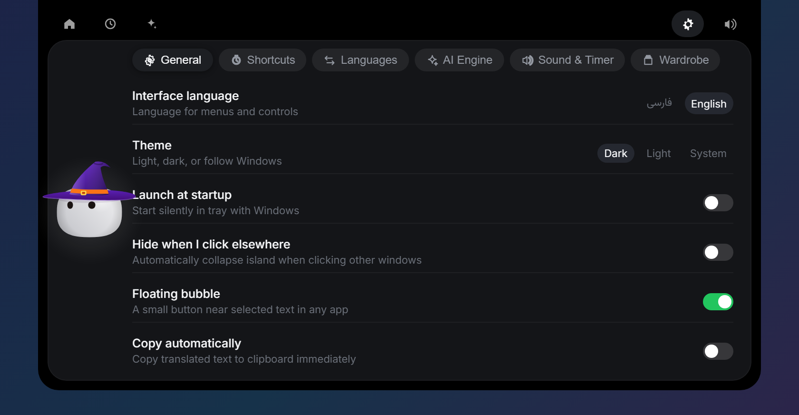
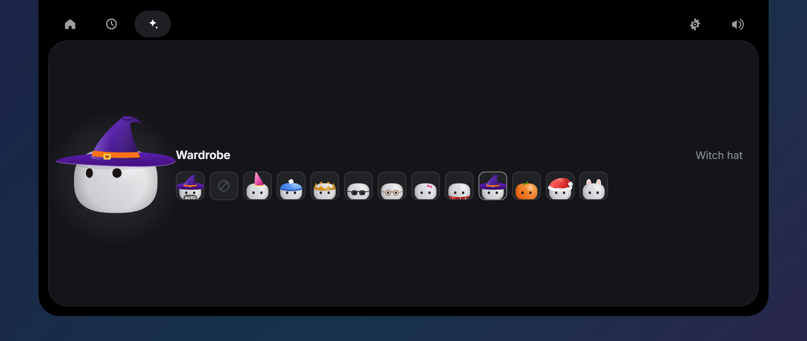
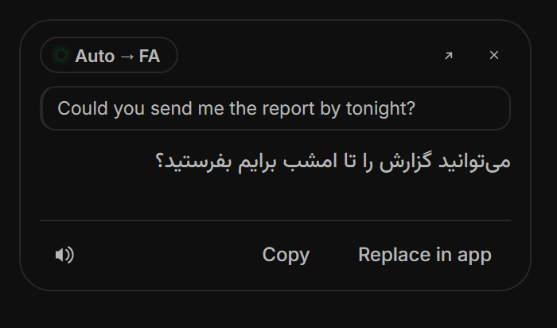

<div align="center">


# آریزو ترنسلیت (Arizo Translate)

**دوست کوچکی که بالای صفحه‌ی ویندوز شما زندگی می‌کند — و هر متنی را، در هر برنامه‌ای، بدون اینکه کارتان را رها کنید ترجمه می‌کند.**

یک «داینامیک آیلند» برای ترجمه. «آری»، شخصیت کوچک برنامه، نشانگر ماوس شما را دنبال می‌کند؛ و یک میانبر متنی را که همین الان تایپ کرده‌اید همان‌جا با ترجمه‌اش جایگزین می‌کند. فارسی ⇄ انگلیسی به‌صورت پیش‌فرض، و بیش از ۱۰۰ زبان در پشت آن.

[](https://github.com/ArizoOwner/Arizo_Agent/releases)


[](https://github.com/ArizoOwner/Arizo_Agent/stargazers)

**🌐 زبان مستندات:** [English](README.md) • فارسی


[قابلیت‌ها](#قابلیتها) • [نصب](#نصب) • [میانبرها](#کلیدهای-میانبر) • [موتورها](#دو-موتور-ترجمه) • [حریم خصوصی](#حریم-خصوصی) • [ساخت](#ساخت-از-روی-سورس) • [لایسنس](#لایسنس)

</div>

<div dir="rtl">

---

## چرا؟

رفت‌وآمد میان تب مرورگر، سایت ترجمه و پنجره‌ای که در آن کار می‌کنید، تمرکز را می‌شکند. **آریزو ترنسلیت سر راه شما نمی‌ایستد.** بالای صفحه می‌ماند، هرگز فوکوس برنامه‌ی فعال شما را نمی‌گیرد و به یک میانبر یا انتخاب متن پاسخ می‌دهد.

با **آری** آشنا شوید: یک مربع‌گرد نرم با دو چشم تیره که نفس می‌کشد، پلک می‌زند، از هر جای صفحه نشانگر ماوس را نگاه می‌کند، وقتی ترجمه در راه است فکر می‌کند و وقتی کپی می‌کنید جشن می‌گیرد.

## قابلیت‌ها

- 🏝️ **یک جزیره‌ی واقعی** — جزیره‌ای بدون قاب و همیشه روی بقیه‌ی پنجره‌ها، در وسط بالای مانیتوری که روی آن کار می‌کنید. ارتفاعش دقیقاً به اندازه‌ی محتواست، پس بخش خالی آن هرگز جلوی کلیک روی برنامه‌ی زیرش را نمی‌گیرد. با `Ctrl+M` به یک کپسول تبدیل می‌شود.
- ⚡ **ترجمه درجا — `Alt+Shift+D`** — در تلگرام، دیسکورد، ورد، نوت‌پد، فرم‌های وب یا IDE تایپ کنید و میانبر را بزنید؛ متن شما همان‌جا که نوشته شده با ترجمه‌اش جایگزین می‌شود. چیزی انتخاب نشده؟ کل کادر ترجمه می‌شود. هیچ پنجره‌ای باز نمی‌شود.
- 🎯 **دکمه‌ی شناور ترجمه‌ی سریع** — در هر جا با کشیدن ماوس متنی را انتخاب کنید: دکمه‌ای کوچک کنار نشانگر ظاهر می‌شود. کلیک کنید تا ترجمه شود؛ بعد کپی کنید، بشنوید یا جایگزین متن انتخاب‌شده کنید. کلیک ساده، دابل‌کلیک، دسکتاپ و تسک‌بار هرگز آن را فعال نمی‌کنند و تا پیش از کلیک شما به کلیپ‌بوردتان دست زده نمی‌شود.
- 🧠 **مدیریت هوشمند زبان** — جهت خودکار (زبان اول شما ← زبان دوم، هر چیز دیگر ← زبان اول؛ با `Ctrl+S` عوض می‌شود)، تشخیص آگاه از فارسی حتی برای جمله‌های پر از واژه‌های فنی انگلیسی، و صیقل اصطلاحات که ترجمه‌ی تحت‌اللفظی را با معادل طبیعی عوض می‌کند («سنگ تمام گذاشت» ← *spared no effort*، *piece of cake* ← «مثل آب خوردن»).
- 🔁 **دو موتور، هرگز دست‌خالی نمی‌مانید** — موتور رایگان **سریع** و موتور مبتنی بر مدل زبانی **هوشمند**. اگر هوشمند شکست بخورد (نبودن کلید، قطع شبکه، تمام شدن سهمیه) ترجمه با سریع انجام می‌شود و دلیلش به شما گفته می‌شود.
- 🗣️ **تلفظ صوتی برای همه‌ی زبان‌ها** — از جمله فارسی که ویندوز صدایی برایش ندارد.
- 📋 **کپی دوزبانه، پاک‌کننده‌ی شکست خطوط PDF، تاریخچه‌ی قابل جستجو** — متن اصلی و ترجمه را با هم کپی کنید، خطوط شکسته‌ی متن چسبانده‌شده از PDF را درست کنید، و آنچه ترجمه کرده‌اید را نشان‌گذاری و جستجو کنید. تاریخچه‌ی نسخه‌ی ۲ در اولین اجرا وارد می‌شود.
- 👗 **لباس تنِ آری کنید** — کمد لباسی از کلاه و لوازم (کلاه جادوگر، کلاه جشن، تاج، عینک آفتابی، گوش خرگوش…) که خودش هم با فصل‌ها عوض می‌شود.
- 🔊 **۲۹ صدای اورجینال** — برای هر حرکت یک صدای نرم و ساخته‌شده، که همه با کد تولید می‌شوند (`npm run sounds`). در تنظیمات قطع یا بلندیش را تنظیم کنید.
- 🌓 **ظاهری که به دل می‌نشیند** — تیره، روشن یا هماهنگ با ویندوز. رابط فارسی (راست‌به‌چپ، فونت وزیرمتن) یا انگلیسی، که در **تنظیمات** (`Ctrl+,`) بی‌درنگ عوض می‌شود.
- 🔒 **حریم خصوصی از پایه** — بدون تلمتری؛ کلید API شما در Windows Credential Manager می‌ماند و هرگز به صفحه‌ی برنامه نمی‌رسد.
- 🪶 **سبک** — نصب‌کننده‌ی ۳٫۷ مگابایتی و نسخه‌ی پرتابل ۷٫۵ مگابایتی. Rust و WebView2 خود ویندوز، به‌جای یک Chromium همراه برنامه.

</div>

<div align="center">

| | |
| :---: | :---: |
| <br>**رابط انگلیسی** | <br>**تم روشن** |
| <br>**تنظیمات** | <br>**کمد لباس آری** |
| <br>**دکمه‌ی شناور ترجمه** | <br>**حالت کپسول** |

</div>

<div dir="rtl">

## دو موتور ترجمه

| موتور | چیست | مناسب برای |
| :--- | :--- | :--- |
| **⚡ سریع** | سرویس رایگان گوگل ترنسلیت و MyMemory به‌عنوان شانس دوم. بدون کلید و بدون محدودیت؛ متن بلند خودکار تکه‌تکه می‌شود. | مطالعه و چت روزمره |
| **✦ هوشمند** | یک مدل زبانی: کنترل لحن (رسمی، محاوره‌ای، فنی، ادبی)، تحلیل اصطلاحات، جمله‌بندی‌های جایگزین، با نمایش زنده‌ی ترجمه هنگام نوشته شدن. | عامیانه، اصطلاح، کد، نامه‌ی رسمی |

**سرویس‌دهنده‌های هوشمند:** OpenRouter، Google Gemini، DeepSeek، Groq، OpenAI و مدل‌های محلی (Ollama و LM Studio) که کلید نمی‌خواهند — یا هر آدرس سازگار با OpenAI.

## کلیدهای میانبر

| میانبر | عملکرد |
| :--- | :--- |
| `Alt+D` | باز یا بسته کردن جزیره (روی متن انتخاب‌شده، اگر باشد) |
| `Alt+Shift+D` | ترجمه درجا در هر برنامه |
| `Ctrl+Tab` | تعویض موتور |
| `Ctrl+S` | جابه‌جایی زبان‌ها |
| `Ctrl+M` | حالت کپسول |
| `Ctrl+,` | تنظیمات |
| `Enter` | کپی و بستن |
| `Ctrl+Enter` | جایگزینی متن در برنامه‌ای که از آن آمده‌اید |
| `Esc` | بستن |

دو میانبر سراسری در **تنظیمات** قابل تغییرند: روی کادر کلیک کنید و کلیدهای تازه را بزنید. اگر برنامه‌ی دیگری آن ترکیب را گرفته باشد، ترکیب قبلی حفظ می‌شود.

## نصب

از صفحه‌ی [Releases](https://github.com/ArizoOwner/Arizo_Agent/releases) دانلود کنید:

| فایل | توضیح |
| :--- | :--- |
| `Arizo-Translate-Setup-3.0.0.exe` | نصب برای کاربر فعلی — بدون نیاز به دسترسی ادمین |
| `Arizo-Translate-3.0.0-Portable.exe` | یک فایل اجرایی، بدون نیاز به نصب |
| `SHA256SUMS.txt` | چک‌سام هر دو فایل |

نصب‌کننده **امضای دیجیتال ندارد**، پس ویندوز بار اول هشدار SmartScreen نشان می‌دهد: روی **More info** و سپس **Run anyway** بزنید. برنامه متن‌باز است؛ می‌توانید کدش را بخوانید یا خودتان بسازیدش.

برنامه در ناحیه‌ی اعلان‌ها (Tray) می‌ماند. بستن جزیره فقط آن را پنهان می‌کند؛ از منوی Tray خارج شوید.

## حریم خصوصی

- **بدون تلمتری.** چیزی جز آنچه خودتان خواسته‌اید به جایی فرستاده نمی‌شود.
- متنی که ترجمه می‌کنید به موتور انتخابی شما می‌رود: گوگل (و MyMemory به‌عنوان پشتیبانش) برای موتور سریع و سرویس‌دهنده‌ی شما برای موتور هوشمند. تلفظ صوتی به سرویس گفتار گوگل می‌رود.
- **کلید API** در Windows Credential Manager نگهداری می‌شود؛ هرگز در فایل نوشته نمی‌شود و به صفحه‌ی برنامه هم داده نمی‌شود — رابط فقط می‌تواند بپرسد که کلیدی وجود دارد یا نه.
- تنظیمات و تاریخچه روی رایانه‌ی خودتان می‌مانند، در `%APPDATA%\Arizo Translate`.
- کلیپ‌بورد شما برای لحظه‌ای برای خواندن متن انتخابی یا چسباندن ترجمه قرض گرفته می‌شود و (متن و تصویر) سر جایش برمی‌گردد.

## ساخت از روی سورس

به [Rust](https://rustup.rs)، [Node.js 20 به بالا](https://nodejs.org) و **ابزار ساخت MSVC** (Visual Studio Build Tools با گزینه‌ی «Desktop development with C++») نیاز دارید. WebView2 همراه ویندوز ۱۰ و ۱۱ است.

</div>

```powershell
git clone https://github.com/ArizoOwner/Arizo_Agent.git
cd Arizo_Agent
npm install
npm install --prefix web
npm run dev            # اجرای توسعه با بارگذاری زنده
npm test               # تست‌های Rust و فرانت‌اند
npm run pack           # نصب‌کننده + نسخه‌ی پرتابل + چک‌سام در release/
```

```
web/                      جزیره، دکمه‌ی شناور و پنجره‌ی تنظیمات
  src/ari/                آری: موتور، کمد لباس، لباس‌ها
  src/views/              ترجمه، تاریخچه، تنظیمات، لیست کشویی هم‌تم
  src/core/               state، bridge، تم، صدا، چیدمان…
src-tauri/src/            بک‌اند Rust
  lib.rs                  پنجره‌ها، Tray، میانبرها، فرمان‌هایی که صفحه صدا می‌زند
  input.rs                Win32: کپی، چسباندن، فوکوس، دیده‌بان انتخاب متن
  google.rs  aphra.rs     دو موتور ترجمه         translator.rs  کش، جایگزینی، تاریخچه
  langs.rs  idioms.rs     تشخیص و صیقل           store.rs       تنظیمات، تاریخچه، کلید API
  textutil.rs  tts.rs     تکه‌کردن متن و گفتار
scripts/                  تولیدکننده‌ی آیکون و صدا، بسته‌بندی
```

<div dir="rtl">

آیکون با کد کشیده می‌شود (`npm run icons`) و صداها هم با کد ساخته می‌شوند (`npm run sounds`): هیچ فایل طراحی باینری‌ای نیست که بخواهید هماهنگش نگه دارید.

## ارتقا از نسخه ۲

در اولین اجرا، تنظیمات و تاریخچه‌ی نسخه‌ی الکترون (`%USERPROFILE%\.aphra-translate`) وارد می‌شود. کلید API آن نسخه برای همان برنامه رمز شده بود و این برنامه نمی‌تواند بخواندش: یک بار در **تنظیمات** دوباره واردش کنید.

## مشارکت

Issue و Pull Request خوش‌آمد است. پیش از ارسال، `npm test` را اجرا کنید. ترجمه‌های رابط کاربری در `web/src/i18n/` هستند.

## قدردانی

جزیره و موتور آری از [Coucou](https://github.com/Louis-CFM/coucou) ساخته‌ی Louis Raillé (MIT) پورت شده است — [NOTICE.md](NOTICE.md) را ببینید. فونت‌ها: [وزیرمتن](https://github.com/rastikerdar/vazirmatn) و [Inter](https://rsms.me/inter/) (SIL OFL). ساخته‌شده با [Tauri](https://tauri.app/).

## لایسنس

- **کد:** [MIT](LICENSE) — استفاده کنید، فورک کنید، از آن یاد بگیرید؛ فقط اعلان کپی‌رایت را نگه دارید.
- **نام، آیکون، صداها و رسانه‌ها:** © ArizoOwner، تمام حقوق محفوظ — [LICENSE-ASSETS.md](LICENSE-ASSETS.md) را ببینید. فورک خودتان را منتشر می‌کنید؟ نام و آیکون خودتان را به آن بدهید.

</div>

<div align="center">

**اگر آری لبخندی روی لبتان آورد، یک ⭐ خیلی کمک می‌کند.**

ساخته‌شده با دقت توسط [ArizoOwner](https://github.com/ArizoOwner) · [ArizoTeam.ir](https://arizoteam.ir)

</div>
