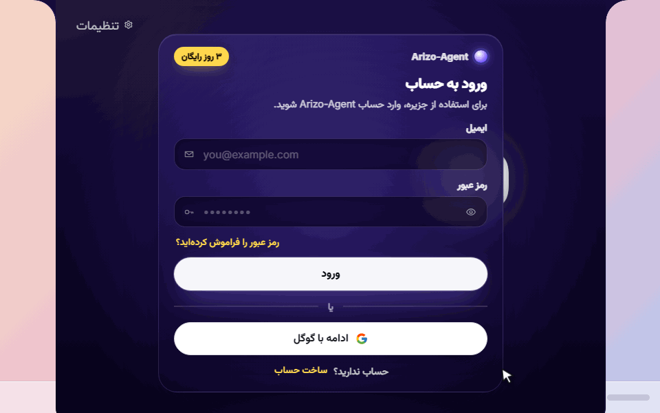
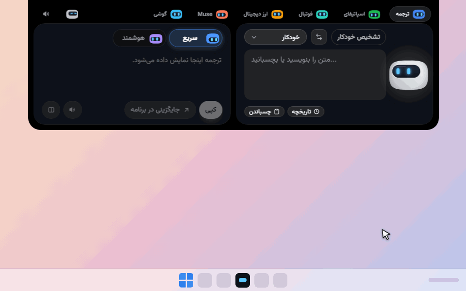
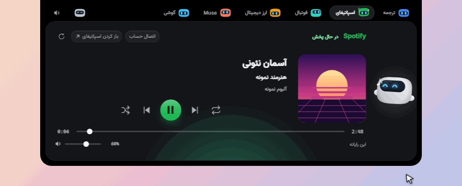
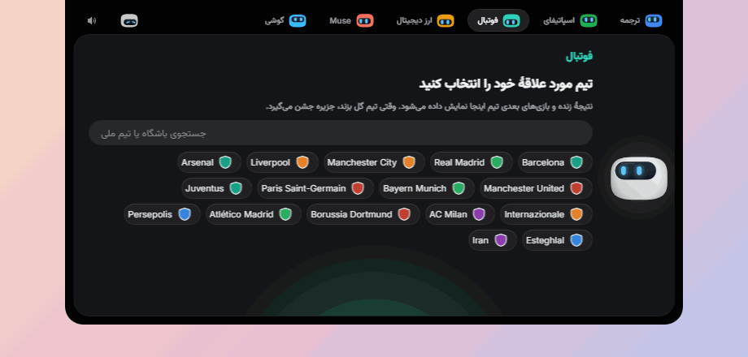
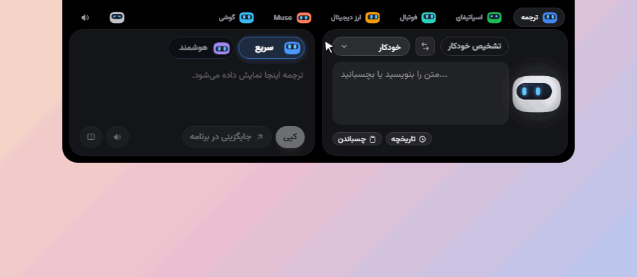
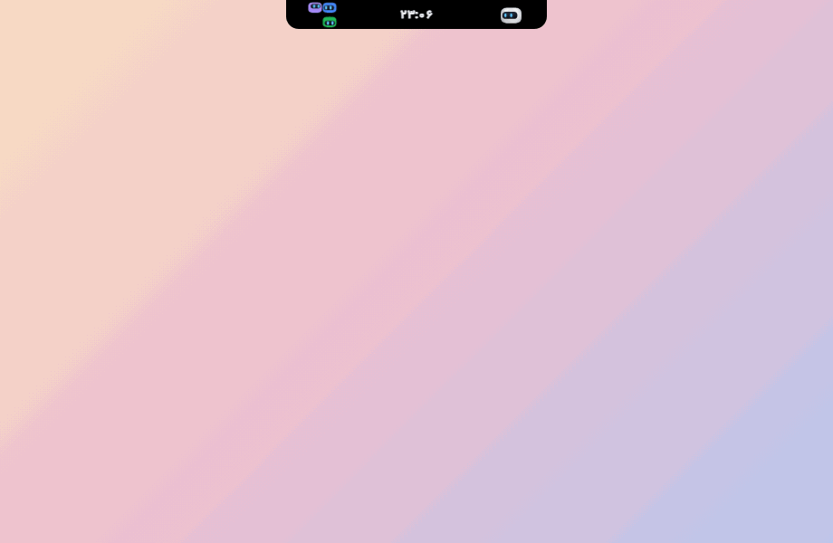
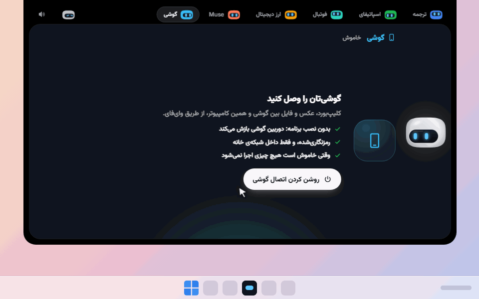

[English](README.md)

**یک «داینامیک آیلند» برای دسکتاپ ویندوز.** هر متنی را ترجمه می‌کند، موسیقی‌تان را پخش می‌کند، تیم فوتبال‌تان را دنبال می‌کند، قیمت ارز دیجیتال را زنده نشان می‌دهد، Muse را می‌آورد و گوشی‌تان را وصل می‌کند — و رباتی کوچک به نام **آری** همراه‌تان است.

<table>
<tr>
<td width="54%" valign="top">

</td>
<td width="46%" valign="middle" dir="rtl">

### تازه در ۲٫۰ · حساب شما، همه‌جا

- **حساب کاربری برای جزیره:** در خود جزیره یا روی سایت، با ایمیل یا گوگل؛ یک حساب برای همه‌ی کامپیوترها
- **روزهای رایگان، بعد اشتراک:** ۱، ۳، ۶ یا ۱۲ ماهه، با پرداخت TON از هر کیف پولی که خودکار تأیید می‌شود
- **پشتیبانی:** تلگرام یا تیکت زنده، مستقیم از صفحه‌ی حساب
- **به‌روزرسانی خودکار** و تنظیماتی تازه و مرتب با جستجو

همچنین در ۱٫۴: آیلند یک‌تکه با صفحه و پیش‌نمایش با رفتن موس.

[**دانلود ۲٫۰ (پیش‌انتشار) ←**](https://github.com/ArizoOwner/Arizo_Agent/releases/tag/v2.0.0)

</td>
</tr>
</table>

<table>
<tr>
<td width="50%" valign="top" dir="rtl">

**ترجمه در هر جا** با `Alt+Shift+D` متن شما در همان برنامه به ترجمه‌اش تبدیل می‌شود.

</td>
<td width="50%" valign="top" dir="rtl">

**موسیقی در جزیره** اسپاتیفای روی همین کامپیوتر یا حساب شما — و آری با آن می‌رقصد.

</td>
</tr>
<tr>
<td width="50%" valign="top" dir="rtl">

**فوتبال زنده** نتیجه، پیراهن تیم و یک جشن برای هر گل.

</td>
<td width="50%" valign="top" dir="rtl">

**کمد لباس آری** کلاه‌ها، فصل‌ها و هالووین — به سلیقه‌ی خودتان.

</td>
</tr>
<tr>
<td width="50%" valign="top" dir="rtl">

**ارز دیجیتال زنده** قیمت و نمودار شمعی صرافی شما، همیشه در دسترس.

</td>
<td width="50%" valign="top" dir="rtl">

**پل ارتباطی** فایل و متن با گوشی، در خانه یا از هر جا با رله‌ی خودتان؛ کامپیوتر دیگری را هم وصل کنید.

</td>
</tr>
</table>

🪟 ویندوز ۱۰ و ۱۱ &nbsp;·&nbsp; 🌐 فارسی و English &nbsp;·&nbsp; 🔒 بدون تلمتری — کلیدهای شما روی کامپیوتر خودتان می‌ماند &nbsp;·&nbsp; 🛰️ رله‌ی خودتان، رمزنگاری‌شده از سر تا ته

دانلود، معرفی کامل قابلیت‌ها و اخبار در **[arizoteam.ir](https://arizoteam.ir)**.

© ۲۰۲۶ ArizoTeam. همه‌ی حقوق محفوظ است. آریزو ایجنت نرم‌افزاری اختصاصی است؛ [LICENSE](LICENSE) را ببینید.

