<div align="center">


<br>

[](https://github.com/ArizoOwner/Arizo_Agent/releases)


[](https://github.com/ArizoOwner/Arizo_Agent/stargazers)

**🌐 زبان مستندات:** [English](README.md) • فارسی

**یک «داینامیک آیلند» برای دسکتاپ ویندوز شما. هر متنی را ترجمه می‌کند، موسیقی‌تان را پخش می‌کند، تیم فوتبال محبوبتان را دنبال می‌کند، قیمت ارز دیجیتال را زنده نشان می‌دهد، Muse را به جزیره می‌آورد — و یک شخصیت کوچک به نام «آری» همراهتان است.**

[⬇️ دانلود](https://github.com/ArizoOwner/Arizo_Agent/releases) • [قابلیت‌ها](#همه-چیز-در-یک-نگاه) • [ترجمه](#ترجمه-در-هر-جا) • [اسپاتیفای](#اسپاتیفای-در-جزیره) • [فوتبال](#فوتبال-زنده) • [ارز دیجیتال](#ارز-دیجیتال-زنده) • [Muse](#muse-در-جزیره) • [کمد لباس](#کمد-لباس-آری) • [مال خودتان کنید](#مال-خودتان-کنید) • [میانبرها](#کلیدهای-میانبر) • [نصب](#شروع-کنید) • [حریم خصوصی](#حریم-خصوصی-از-پایه) • [ساخت](#برای-توسعه‌دهندگان)


</div>

<div dir="rtl">

## همه چیز در یک نگاه

</div>

<div align="center">


</div>

<div dir="rtl">

آریزو ایجنت در وسط بالای صفحه‌ی شما، در یک **جزیره‌ی** بدون قاب و همیشه روی بقیه‌ی پنجره‌ها زندگی می‌کند. ارتفاع جزیره دقیقاً به اندازه‌ی محتواست؛ پس بخش خالی آن هرگز جلوی کلیک روی برنامه‌ی زیرش را نمی‌گیرد و فوکوس کار شما را هم نمی‌دزدد. با `Ctrl+M` به یک کپسول تبدیل می‌شود و با `Alt+D` از هر جا باز می‌شود.

با **آری** آشنا شوید: یک مربع‌گرد نرم با دو چشم تیره که نفس می‌کشد، پلک می‌زند، از هر جای صفحه نشانگر ماوس را نگاه می‌کند، وقتی ترجمه در راه است فکر می‌کند، وقتی موسیقی پخش می‌شود می‌رقصد و وقتی تیمتان گل می‌زند جشن می‌گیرد.

</div>

<br>


<div align="center">

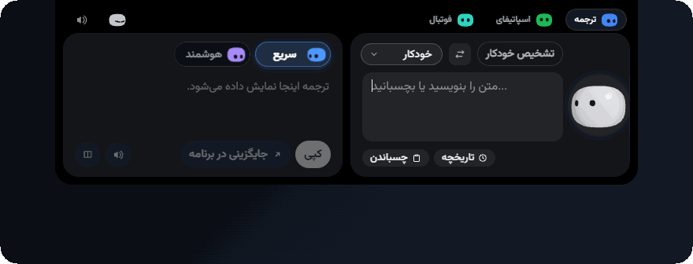

</div>

<div dir="rtl">

## ترجمه در هر جا

- ⚡ **ترجمه درجا — `Alt+Shift+D`.** در تلگرام، دیسکورد، ورد، نوت‌پد، فرم‌های وب یا IDE تایپ کنید و میانبر را بزنید؛ متن شما همان‌جا که نوشته شده با ترجمه‌اش جایگزین می‌شود. چیزی انتخاب نشده؟ کل کادر ترجمه می‌شود. هیچ پنجره‌ای باز نمی‌شود.
- 🎯 **دکمه‌ی شناور ترجمه‌ی سریع.** در هر جا با کشیدن ماوس متنی را انتخاب کنید: دکمه‌ای کوچک کنار نشانگر ظاهر می‌شود. کلیک کنید تا ترجمه شود؛ بعد کپی کنید، بشنوید یا جایگزین متن انتخاب‌شده کنید. کلیک ساده، دابل‌کلیک، دسکتاپ و تسک‌بار هرگز آن را فعال نمی‌کنند و تا پیش از کلیک شما به کلیپ‌بوردتان دست زده نمی‌شود.
- 🧠 **مدیریت هوشمند زبان.** جهت خودکار (زبان اول شما ← زبان دوم، هر چیز دیگر ← زبان اول؛ با `Ctrl+S` عوض می‌شود)، تشخیص آگاه از فارسی حتی برای جمله‌های پر از واژه‌های فنی انگلیسی، و صیقل اصطلاحات که ترجمه‌ی تحت‌اللفظی را با معادل طبیعی عوض می‌کند («سنگ تمام گذاشت» ← *spared no effort*، *piece of cake* ← «مثل آب خوردن»).
- 🔁 **هرگز دست‌خالی نمی‌مانید.** اگر موتور هوشمند شکست بخورد (نبودن کلید، قطع شبکه، تمام شدن سهمیه) ترجمه با موتور سریع انجام می‌شود و دلیلش به شما گفته می‌شود.
- 🗣️ **تلفظ صوتی برای همه‌ی زبان‌ها** — از جمله فارسی که ویندوز صدایی برایش ندارد.
- 📋 **کپی دوزبانه، پاک‌کننده‌ی شکست خطوط PDF، تاریخچه‌ی قابل جستجو.** متن اصلی و ترجمه را با هم کپی کنید، خطوط شکسته‌ی متن چسبانده‌شده از PDF را یکی کنید، و از داخل بخش ترجمه **تاریخچه** را باز کنید تا ترجمه‌های قبلی را ستاره بزنید، جستجو کنید و دوباره ترجمه کنید.

</div>


<div dir="rtl">

## دو موتور ترجمه

| موتور | چیست | مناسب برای |
| :--- | :--- | :--- |
| **⚡ سریع** | سرویس رایگان گوگل ترنسلیت و MyMemory به‌عنوان شانس دوم. بدون کلید و بدون محدودیت؛ متن بلند (تا ۳۰٬۰۰۰ نویسه) تکه‌تکه ترجمه می‌شود و کامل برمی‌گردد. | مطالعه و چت روزمره |
| **✦ هوشمند** | یک مدل زبانی: کنترل لحن (رسمی، محاوره‌ای، فنی، ادبی)، تحلیل اصطلاحات، جمله‌بندی‌های جایگزین، با نمایش زنده‌ی ترجمه هنگام نوشته شدن؛ متن بلند هم تکه‌تکه و کامل ترجمه می‌شود. | عامیانه، اصطلاح، کد، نامه‌ی رسمی |

**سرویس‌دهنده‌های هوشمند:** OpenRouter، Google Gemini، DeepSeek، Groq، OpenAI و مدل‌های محلی (Ollama و LM Studio) که کلید نمی‌خواهند — یا هر آدرس سازگار با OpenAI. موتور را با `Ctrl+Tab` عوض کنید.

</div>


<div align="center">

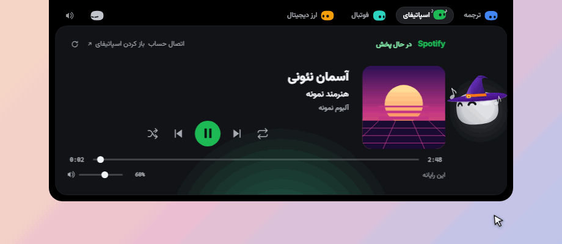

</div>

<div dir="rtl">

## اسپاتیفای در جزیره

دو راه برای گوش دادن — و می‌توانید هر دو را با هم داشته باشید.

- 🖥️ **روی همین رایانه، بدون هیچ تنظیمی.** جزیره برنامه‌ی دسکتاپ اسپاتیفای را از راه کنترل‌های رسانه‌ی ویندوز می‌خواند و کاور، نام آهنگ، خواننده و زمان را نشان می‌دهد؛ با پخش/توقف، قبلی/بعدی، جابه‌جایی زمان، پخش تصادفی، تکرار و صدای خود اسپاتیفای.
- ☁️ **با حساب خودتان.** یک بار وصل کنید (OAuth با PKCE — Client ID یک برنامه‌ی رایگان توسعه‌دهنده را که خودتان می‌سازید می‌چسبانید و دسترسی را در مرورگر تأیید می‌کنید؛ هیچ Client Secret وجود ندارد) تا پخش گوشی و دستگاه‌های دیگر را هم ببینید و کنترل کنید. کنترل با حساب به Premium نیاز دارد؛ حساب رایگان فقط می‌تواند ببیند. اگر هر دو پخش کنند، حساب اولویت دارد مگر اینکه فقط همین رایانه پخش کند.
- 💃 **آری با ضرب آهنگ می‌رقصد** (۱۱۲ ضرب در دقیقه) و نت‌های ♪ کنارش بالا می‌روند — سفید روی جزیره‌ی تیره و سیاه روی جزیره‌ی روشن.

</div>


<div align="center">

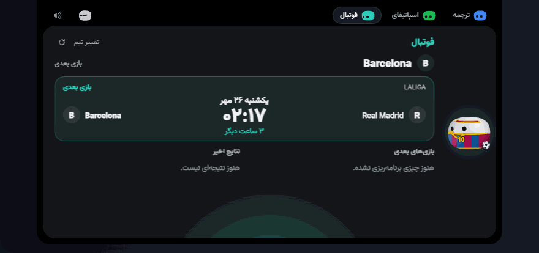

</div>

<div dir="rtl">

## فوتبال زنده

یک بار باشگاه یا تیم ملی‌تان را انتخاب کنید تا جزیره **نتیجه‌ی زنده**، **بازی‌های بعدی** (در کادر مخصوص خودشان) و **نتایج اخیر** را به‌صورت آنلاین نشان دهد — بدون حساب و بدون کلید. تاریخ و ساعت بازی‌ها با زبان شما می‌آید: در فارسی با **تقویم شمسی** و ارقام فارسی و در انگلیسی با **تقویم میلادی**.

نتیجه هنگام بازی تیم شما **هر ۳ ثانیه** خوانده می‌شود و **هر لحظه‌ی بازی نمایش مخصوص خودش را دارد**: جزیره به اندازه‌ی همان رویداد بزرگ می‌شود، آری واکنش نشان می‌دهد و صدای مناسبی پخش می‌شود. چند رویداد هم‌زمان به نوبت نشان داده می‌شوند و رویداد مهم‌تر کم‌اهمیت‌تر را قطع می‌کند. این نمایش‌ها از حالت کپسول و حتی از جزیره‌ی کاملاً پنهان هم کار می‌کنند.

</div>

<div align="center">


</div>

<div dir="rtl">

| لحظه | جزیره | آری | صدا |
| :--- | :--- | :--- | :--- |
| ⚽ گل شما | صحنه‌ی کامل، گل‌باران، گلزن و نتیجه | از شادی می‌پرد، ستاره و قلب | تشویق جمعیت |
| 😬 گل خوردن | قطره‌های آبی، گلزن و نتیجه | چشم‌های خسته و عرق | ناله |
| 🟨 کارت زرد (شما یا حریف) | کارت‌های زردِ در حال ریزش | شگفت‌زده یا چشمک | کارت |
| 🟥 کارت قرمز / اخراج حریف | کارت‌های قرمز و درخشش قرمز | غمگین، یا شاد اگر حریف باشد | کارت |
| 🏁 شروع بازی، نیمه‌ی دوم | ریزش توپ | خوشحال | سوت |
| ⏸️ پایان نیمه‌ی اول | صحنه‌ی آرام | چشمک | سوت |
| 🏆 سوت پایان | برد: کاغذ رنگی. مساوی: آرام. باخت: قطره | شادی، بی‌تفاوتی یا غم | تشویق، سوت یا ناله |

### 👕 آری با پیراهن تیم شما

در بخش فوتبال، آری **پیراهن واقعی تیم موردعلاقه‌تان** را می‌پوشد: راه‌راه آبی و آلبالویی بارسلونا، سفید با حاشیه‌ی مشکی رئال مادرید، یوونتوس، پاری‌سن‌ژرمن، میلان، استقلال… (هر تیم دیگری رنگ خودش را می‌گیرد). پیراهن همراه سر آری سه‌بعدی حرکت می‌کند — وقتی به پایین نگاه می‌کند یا می‌چرخد، یقه و راه‌راه‌ها و آرم و شماره دنبالش می‌آیند و چشم‌هایش هرگز توی لباس فرو نمی‌رود. در تنظیمات می‌توانید آن را خاموش کنید و در بقیه‌ی بخش‌ها آری همان لباس همیشگی‌اش را دارد.

</div>

<div align="center">


</div>


<div align="center">

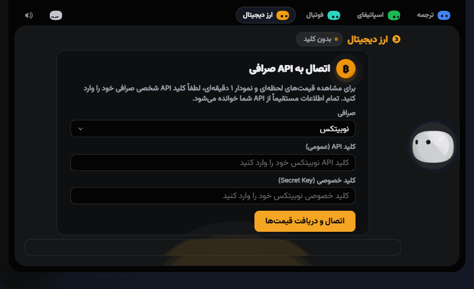

</div>

<div dir="rtl">

## ارز دیجیتال زنده

**از نسخه‌ی ۳٫۳.** یک بار **حساب صرافی خودتان** را وصل کنید تا جزیره **قیمت زنده‌ی** هر ارز، یک **نمودار کندل‌استیک** و **ارزهای موردعلاقه‌تان** را نشان دهد — مستقیم از خود صرافی، بدون واسطه و بدون هیچ عدد ساختگی. تا وقتی صرافی کلید شما را نپذیرفته باشد، چیزی نشان داده نمی‌شود.

</div>

<div align="center">


</div>

<div dir="rtl">

- 🏦 **صرافی شما، کلید شما.** **نوبیتکس**، **بایننس** یا **توبیت** را انتخاب کنید و یک کلید API **فقط‌خواندنی** بچسبانید. برنامه فقط می‌خواند: هرگز معامله، برداشت یا سفارش ثبت نمی‌کند.
- 📈 **کندل از یک دقیقه تا یک روز.** نمودار کندل‌استیک (یا خطی) همراه حجم، خط راهنمای ماوس و باز، بالا، پایین و بسته‌ی هر کندل — به‌علاوه‌ی بالاترین، پایین‌ترین و حجم ۲۴ ساعته. **تایم‌فریم را از یک لیست کشویی** انتخاب کنید: ۱ دقیقه، ۵ دقیقه، ۱۵ دقیقه، ۱ ساعت، ۴ ساعت یا ۱ روز.
- 🪙 **فهرست ارزها از صرافی می‌آید.** همه‌ی ارزهایی که صرافی عرضه می‌کند، با قیمت و درصد تغییر، در لیست کشویی قابل جست‌وجو هستند و **آیکون ارزها آنلاین بارگذاری می‌شود** (اگر آیکونی نبود، یک نماد کشیده‌شده جایش می‌نشیند).
- ⭐ **موردعلاقه‌ها و ارز پیش‌فرض.** ارزهایی را که دنبال می‌کنید ستاره بزنید (تا ۴۰ ارز)؛ در نواری زیر انتخاب‌گر می‌نشینند تا با یک کلیک جابه‌جا شوید. یکی را **پیش‌فرض** کنید: هر بار که برنامه شروع می‌شود، جزیره اول همان را نشان می‌دهد.
- 💵 **تومان با `T`، دلار با `$`.** در نوبیتکس قیمت بین تومان — به‌صورت `4,795,000,000 T` در یک خط و با محور نمودار بر حسب میلیون — و تتر جابه‌جا می‌شود. **تتر** هم در فهرست هست.
- 🌓 **هماهنگ با ظاهر برنامه.** تم روشن و تیره؛ و رابط فارسی همه‌چیز را راست‌به‌چپ و با ارقام محکم وزیرمتن می‌چیند.
- 🔋 **وقتی نگاه نمی‌کنید، ساکت است.** قیمت‌ها **فقط وقتی بخش ارز دیجیتال روی صفحه است** خوانده می‌شوند (هر ۵ ثانیه در نوبیتکس، ۳ ثانیه در توبیت و ۲ ثانیه در بایننس) و بعد برنامه دوباره می‌خوابد.

</div>

<div align="center">


</div>

<div dir="rtl">

| صرافی | کلید شما | قیمت به |
| :--- | :--- | :--- |
| **نوبیتکس** | کلید عمومی + کلید خصوصی (*حساب کاربری ← سرویس‌های API*، دسترسی خواندن). هر درخواست با Ed25519 امضا می‌شود؛ کلید خصوصی فقط یک بار، هنگام ساخت، نشان داده می‌شود | تومان و تتر |
| **بایننس** | کلید API + راز (فقط‌خواندنی)، امضا با HMAC-SHA256 | تتر |
| **توبیت** | کلید API + راز (فقط‌خواندنی)، امضا با HMAC-SHA256 | تتر |

در نوبیتکس تتر فقط با تومان معامله می‌شود و قیمت تومانی‌اش نشان داده می‌شود (نوبیتکس برای آن کندل منتشر نمی‌کند، پس فقط قیمت زنده و آمار ۲۴ ساعته دیده می‌شود). کلیدها را هر زمان با **تغییر API** عوض یا پاک کنید و کل این بخش را در **تنظیمات** خاموش کنید.

</div>


<div align="center">


</div>

<div dir="rtl">

## Muse در جزیره

**تازه در نسخه‌ی ۳٫۵.** بخش تازه‌ی **Muse** خودِ وب‌اپ muse.ai را داخل جزیره می‌آورد — همان سایت واقعی، زنده، با حساب و چت‌های خودتان، نه یک کپی. وقتی باز است جزیره مثل یک تبلت کوچک می‌ایستد و با بیرون رفتن نشانگر بسته نمی‌شود؛ یک کلیک بیرون از آن جمعش می‌کند.

- 💤 **خاموش تا وقتی بخواهید.** Muse با هر بار اجرای برنامه، از جمله هنگام روشن شدن ویندوز، خاموش است: هیچ بخشی از آن اجرا نمی‌شود، پس حافظه، پردازنده و اینترنت مصرف نمی‌کند. آری وسط بخش کنار دکمه‌ی روشن کردن خوابیده و دکمه‌ی پاور نوار ابزارش دوباره خاموشش می‌کند — بدون اینکه از حسابتان خارج شوید.
- 🔌 **آری هنگام وصل شدن.** آری دنبالش می‌گردد و مرحله‌ها یکی‌یکی روشن می‌شوند؛ اگر باز نشود، آری همین را می‌گوید و **دوباره امتحان کن** و **خاموش کردن Muse** را پیشنهاد می‌دهد.
- 🔤 **خوانا در هر دو زبان.** چت با فونت‌های خود جزیره (اینتر و وزیرمتن) نوشته می‌شود و هر پاراگراف، فهرست و کادر متن بر اساس آنچه در آن نوشته شده خودش راست‌چین یا چپ‌چین می‌شود — حتی وقتی جواب در حال نوشته شدن است و وقتی شما تایپ می‌کنید.
- 🛡️ **جدا از برنامه.** سایت در وب‌ویوی جداگانه‌ای اجرا می‌شود که به هیچ فرمانی از برنامه دسترسی ندارد؛ پنجره‌های تازه در مرورگر شما باز می‌شوند. برای خاموش کردن همیشگی، به تنظیمات ← **ابزارک‌های جزیره** بروید.

</div>


<div align="center">

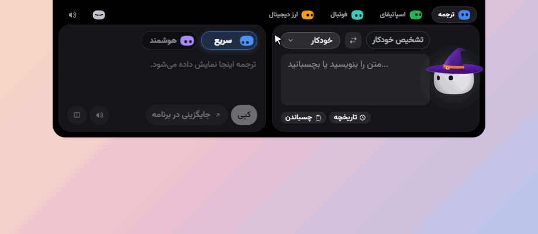

</div>

<div dir="rtl">

## کمد لباس آری

کلاه و لوازم — کلاه جادوگر، کلاه جشن، تاج، عینک آفتابی، گوش خرگوش… — و **فصل‌ها خودشان لباس تنش می‌کنند**. کمد را از **تنظیمات** یا با راست‌کلیک روی آری باز کنید.

</div>


<div align="center">


</div>

<div dir="rtl">

## مال خودتان کنید

**تازه در نسخه‌ی ۳٫۴.** در تنظیمات ← **ظاهر جزیره** جزیره را مال خودتان می‌کنید. هر لغزنده تغییرش را همان لحظه‌ی کشیدن روی خود جزیره نشان می‌دهد، با رها کردن ذخیره می‌شود و دکمه‌ی **برگرداندن به پیش‌فرض** مخصوص خودش را دارد (به‌علاوه‌ی یک دکمه برای همه).

- 📐 **اندازه و شکل.** عرض ۸۰ تا ۱۳۰٪، ارتفاع ۹۰ تا ۱۳۰٪ و گوشه‌ها از تیز تا کاملاً گرد (۰ تا ۱۵۰٪).
- 🫧 **شفافیت.** جزیره و کادرهایش را تا ۷۰٪ شفاف کنید — متن‌ها کاملاً واضح می‌مانند.
- 🔠 **هر اندازه‌ی متن.** از ۸۰٪ تا ۱۴۰٪: دکمه‌ها، کادرها و ردیف‌ها به‌جای بیرون زدن از جزیره، روی هم افتادن یا بریده شدن، خط عوض می‌کنند یا جا را تقسیم می‌کنند — در همه‌ی بخش‌ها، فارسی و انگلیسی.
- 🪂 **شناور.** جزیره را ۴ تا ۶۰ پیکسل پایین‌تر از لبه‌ی بالا آویزان کنید، نه چسبیده به آن.

</div>

<div align="center">

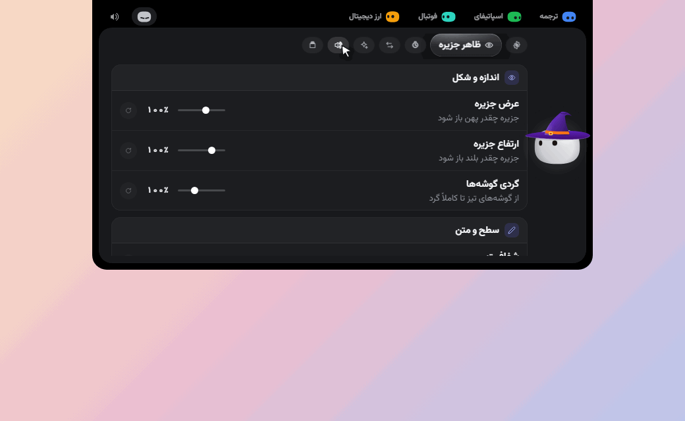

</div>

<div dir="rtl">

- 💊 **جزیره‌ی جمع‌شده هم مال شماست.** کپسول **عرض** (۶۰ تا ۱۶۰٪)، **ارتفاع** (۹۰ تا ۱۸۰٪) و **بزرگنمایی** (۷۰ تا ۱۸۰٪) مخصوص خودش را دارد: آری، ساعت و مینی‌کاراکترها با هم بزرگ و کوچک می‌شوند و همیشه جای خودشان را نگه می‌دارند. تصویر کوچکی بالای لغزنده‌ها آنچه را می‌سازید نشان می‌دهد، چون وقتی تنظیمات باز است خود کپسول دیده نمی‌شود.

</div>

<div align="center">

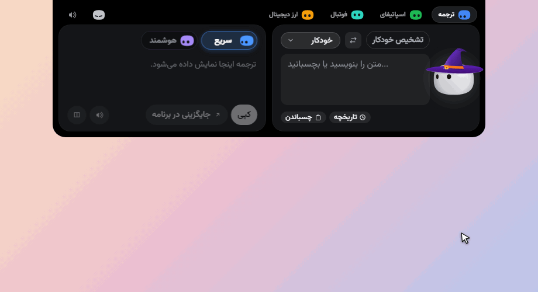

</div>

<div dir="rtl">

- 🧲 **تب‌ها را بکشید.** ترجمه، اسپاتیفای، فوتبال، ارز دیجیتال یا Muse را در بالای جزیره بردارید و هر جا خواستید رها کنید: بقیه کنار می‌روند و ترتیب یادآوری می‌شود (در فارسی آینه‌ای).

## ظاهری که به دل می‌نشیند

</div>

<div align="center">

| | |
| :---: | :---: |
| 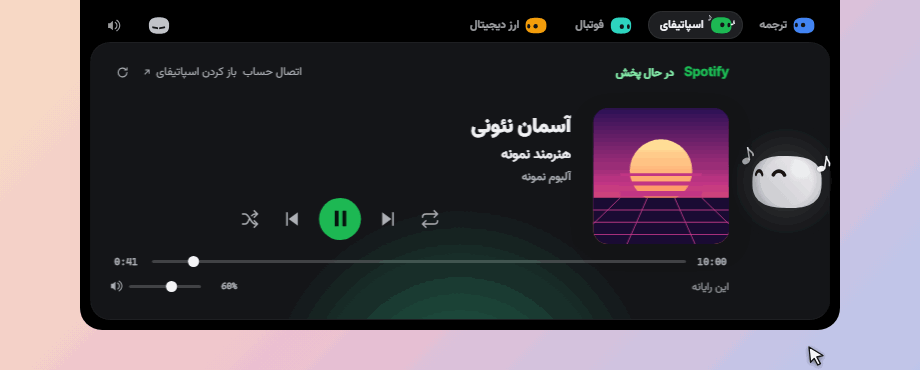<br>**جزیره، کپسول، پنهان** — `Ctrl+M` | 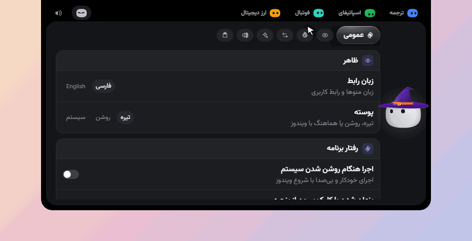<br>**تنظیمات** — `Ctrl+,` |
| <br>**تیره، روشن یا هماهنگ با ویندوز** | 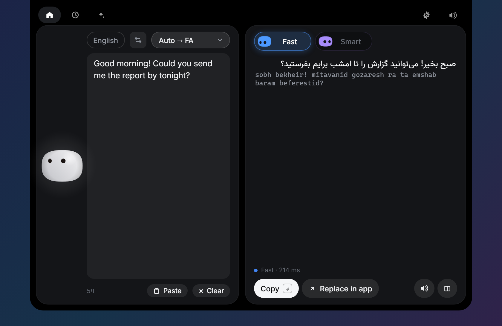<br>**رابط فارسی (راست‌به‌چپ) یا انگلیسی** |

</div>

<div dir="rtl">

- ✨ **یک مینی‌کاراکتر برای هر قابلیت.** ترجمه، اسپاتیفای، فوتبال، ارز دیجیتال و تنظیمات، هرکدام مینی‌کاراکتر متحرک و رنگ مخصوص خود را در بالای جزیره دارند. مینی‌کاراکتر سبز با موسیقی می‌رقصد.
- 🔊 **۳۳ صدای اورجینال** — برای هر حرکت یک صدای نرم و ساخته‌شده، که همه با کد تولید می‌شوند (`npm run sounds`). در تنظیمات قطع یا بلندیش را تنظیم کنید.
- 🌓 **ظاهری که به دل می‌نشیند** — تیره، روشن یا هماهنگ با ویندوز. رابط فارسی (راست‌به‌چپ، فونت وزیرمتن) یا انگلیسی، که بی‌درنگ عوض می‌شود.
- 🪶 **سبک** — Rust و WebView2 خود ویندوز، به‌جای یک Chromium همراه برنامه.

## کلیدهای میانبر

| میانبر | عملکرد |
| :--- | :--- |
| `Alt+D` | باز کردن جزیره (روی متن انتخاب‌شده، اگر باشد) |
| `Alt+Shift+D` | ترجمه درجا در هر برنامه |
| `Alt+Shift+H` | پنهان یا نمایان کردن کامل جزیره |
| `Ctrl+Tab` | تعویض موتور |
| `Ctrl+S` | جابه‌جایی زبان‌ها |
| `Ctrl+M` | حالت کپسول |
| `Ctrl+,` | تنظیمات |
| `Enter` | کپی و بستن |
| `Ctrl+Enter` | جایگزینی متن در برنامه‌ای که از آن آمده‌اید |
| `Esc` | بستن |

سه میانبر سراسری در **تنظیمات** قابل تغییرند: روی کادر کلیک کنید و کلیدهای تازه را بزنید. اگر برنامه‌ی دیگری آن ترکیب را گرفته باشد، ترکیب قبلی حفظ می‌شود.

</div>


<div align="center">


</div>

<div dir="rtl">

## شروع کنید

از صفحه‌ی [Releases](https://github.com/ArizoOwner/Arizo_Agent/releases) دانلود کنید:

| فایل | توضیح |
| :--- | :--- |
| `Arizo-Agent-Setup-3.5.0.exe` | نصب برای کاربر فعلی — بدون نیاز به دسترسی ادمین |
| `Arizo-Agent-3.5.0-Portable.exe` | یک فایل اجرایی، بدون نیاز به نصب |
| `SHA256SUMS.txt` | چک‌سام هر دو فایل |

نصب‌کننده **امضای دیجیتال ندارد**، پس ویندوز بار اول هشدار SmartScreen نشان می‌دهد: روی **More info** و سپس **Run anyway** بزنید. برنامه متن‌باز است؛ می‌توانید کدش را بخوانید یا خودتان بسازیدش.

برنامه در ناحیه‌ی اعلان‌ها (Tray) می‌ماند. بستن جزیره فقط آن را پنهان می‌کند؛ از منوی Tray خارج شوید.

**ارتقا از نسخه‌ی ۲؟** در اولین اجرا، تنظیمات و تاریخچه‌ی نسخه‌ی الکترون (`%USERPROFILE%\.aphra-translate`) وارد می‌شود. کلید API آن نسخه برای همان برنامه رمز شده بود و این برنامه نمی‌تواند بخواندش: یک بار در **تنظیمات** دوباره واردش کنید.

</div>


<div dir="rtl">

## حریم خصوصی از پایه

- **بدون تلمتری.** چیزی جز آنچه خودتان خواسته‌اید به جایی فرستاده نمی‌شود.
- متنی که ترجمه می‌کنید به موتور انتخابی شما می‌رود: گوگل (و MyMemory به‌عنوان پشتیبانش) برای موتور سریع و سرویس‌دهنده‌ی شما برای موتور هوشمند. تلفظ صوتی به سرویس گفتار گوگل می‌رود.
- **کلید API** در Windows Credential Manager نگهداری می‌شود؛ هرگز در فایل نوشته نمی‌شود و به صفحه‌ی برنامه هم داده نمی‌شود — رابط فقط می‌تواند بپرسد که کلیدی وجود دارد یا نه.
- تنظیمات و تاریخچه روی رایانه‌ی خودتان، در `%APPDATA%\Arizo Translate` می‌مانند. نام این پوشه، شناسه‌ی برنامه و محل امن کلید API عمداً حفظ شده‌اند تا ارتقا اطلاعات قبلی شما را پاک نکند.
- اسپاتیفای: روی همین رایانه، جزیره فقط همان وضعیت رسانه‌ای را می‌خواند که ویندوز برای برنامه‌ی اسپاتیفای نشان می‌دهد و درخواست‌های معمول پخش/توقف/بعدی را به آن می‌فرستد؛ چیزی از رایانه‌ی شما بیرون نمی‌رود. حساب اختیاری است و فقط بعد از وصل کردن شما استفاده می‌شود. دسترسی آن وضعیت پخش، کنترل پخش و نوع اشتراک (Premium یا رایگان) است و بیشتر نه. توکن در Windows Credential Manager می‌ماند، نه در فایل و نه در صفحه، و **قطع اتصال** آن را پاک می‌کند.
- فوتبال: جزیره فقط شناسه‌ی تیم شما (و برای بازی زنده، لیگ و روز بازی) را از داده‌های عمومی فوتبال ESPN می‌پرسد؛ هیچ اطلاعاتی از شما فرستاده نمی‌شود، حساب و کلیدی لازم نیست و تیم انتخابی فقط در فایل تنظیمات خودتان می‌ماند. با خاموش کردن آن در تنظیمات هیچ درخواستی فرستاده نمی‌شود.
- ارز دیجیتال: کلید صرافی را خودتان می‌آورید. کلید در Windows Credential Manager نگه‌داری می‌شود (برای هر صرافی یک ورودی جدا)، نه در فایل و نه در صفحه، و **تغییر API** آن را پاک می‌کند. برنامه فقط درخواست خواندن می‌فرستد — قیمت‌ها، کندل‌ها و بررسی اینکه کلید کار می‌کند — آن هم مستقیم به صرافی‌ای که انتخاب کرده‌اید (نوبیتکس، بایننس یا توبیت)؛ هیچ سرور ما در میان نیست و قیمت‌ها فقط وقتی بخش ارز دیجیتال روی صفحه است درخواست می‌شوند. با خاموش کردن این بخش در تنظیمات هیچ درخواستی فرستاده نمی‌شود. تنها استثنا آیکون ارزهاست که از سرورهای عمومی تصویر (cdn.nobitex.ir و در صورت نبودن assets.coincap.io) بارگذاری می‌شود؛ آن سرورها نماد ارزها و نشانی IP شما را می‌بینند.
- کلیپ‌بورد شما برای لحظه‌ای برای خواندن متن انتخابی یا چسباندن ترجمه قرض گرفته می‌شود و (متن و تصویر) سر جایش برمی‌گردد.

</div>


<div dir="rtl">

## برای توسعه‌دهندگان

به [Rust](https://rustup.rs)، [Node.js 20 به بالا](https://nodejs.org) (برای اجرای تست‌ها: Node.js 22.18 به بالا) و **ابزار ساخت MSVC** (Visual Studio Build Tools با گزینه‌ی «Desktop development with C++») نیاز دارید. WebView2 همراه ویندوز ۱۰ و ۱۱ است.

</div>

```powershell
git clone https://github.com/ArizoOwner/Arizo_Agent.git
cd Arizo_Agent
npm install
npm install --prefix web
npm run dev            # اجرای توسعه با بارگذاری زنده
npm test               # تست‌های Rust و فرانت‌اند
npm run pack           # نصب‌کننده + نسخه‌ی پرتابل + چک‌سام در release/
npm run readme-gifs -- translate both   # ضبط یک انیمیشن ریدمی از برنامه‌ی در حال اجرا (اول npm run web)
```

```
web/                      جزیره، دکمه‌ی شناور و پنجره‌ی تنظیمات
  src/ari/                آری: موتور، کمد لباس، لباس‌ها
  src/views/              ترجمه، تاریخچه، تنظیمات، ارز دیجیتال، لیست کشویی هم‌تم
  src/core/               state، bridge، تم، صدا، چیدمان…
src-tauri/src/            بک‌اند Rust
  lib.rs                  پنجره‌ها، Tray، میانبرها، فرمان‌هایی که صفحه صدا می‌زند
  input.rs                Win32: کپی، چسباندن، فوکوس، دیده‌بان انتخاب متن
  google.rs  aphra.rs     دو موتور ترجمه         translator.rs  کش، جایگزینی، تاریخچه
  langs.rs  idioms.rs     تشخیص و صیقل           store.rs       تنظیمات، تاریخچه، کلید API
  textutil.rs  tts.rs     تکه‌کردن متن و گفتار
  crypto.rs               صرافی‌ها: درخواست‌های امضاشده، قیمت، کندل، نظرسنج پس‌زمینه
scripts/                  آیکون، صدا، بسته‌بندی، هنر ریدمی و ضبط‌کننده‌ی انیمیشن‌ها (readme-gifs/)
```

<div dir="rtl">

آیکون با کد کشیده می‌شود (`npm run icons`)، صداها با کد ساخته می‌شوند (`npm run sounds`) و قاب و تزئینات همین صفحه هم با کد تولید می‌شوند (`npm run readme-art`). انیمیشن‌های قابلیت‌ها کشیده نشده‌اند: `npm run readme-gifs` خود رابط واقعی را در یک مرورگر بدون پنجره با رویدادهای واقعی ماوس و کیبورد اجرا می‌کند و آنچه را نقاشی می‌کند ضبط می‌کند؛ پس همیشه همان نسخه‌ای را نشان می‌دهند که در مخزن است.

**مشارکت.** Issue و Pull Request خوش‌آمد است. پیش از ارسال، `npm test` را اجرا کنید. ترجمه‌های رابط کاربری در `web/src/i18n/` هستند. تازه‌ترین تغییرات را در [تاریخچه‌ی تغییرات](CHANGELOG.md) ببینید.

## قدردانی

جزیره و موتور آری از [Coucou](https://github.com/Louis-CFM/coucou) ساخته‌ی Louis Raillé (MIT) پورت شده است — [NOTICE.md](NOTICE.md) را ببینید. فونت‌ها: [وزیرمتن](https://github.com/rastikerdar/vazirmatn) و [Inter](https://rsms.me/inter/) (SIL OFL). ساخته‌شده با [Tauri](https://tauri.app/).

## لایسنس

- **کد:** [MIT](LICENSE) — استفاده کنید، فورک کنید، از آن یاد بگیرید؛ فقط اعلان کپی‌رایت را نگه دارید.
- **نام، آیکون، صداها و رسانه‌ها:** © ArizoOwner، تمام حقوق محفوظ — [LICENSE-ASSETS.md](LICENSE-ASSETS.md) را ببینید. فورک خودتان را منتشر می‌کنید؟ نام و آیکون خودتان را به آن بدهید.

</div>

<div align="center">


</div>
