

<a href="https://arizoteam.ir"></a>

[English](README.md) · **فارسی**

**یک «داینامیک آیلند» برای دسکتاپ ویندوز.** هر متنی را ترجمه می‌کند، موسیقی‌تان را پخش می‌کند، تیم فوتبال‌تان را دنبال می‌کند، قیمت ارز دیجیتال را زنده نشان می‌دهد، FPS بازی‌تان را می‌گوید و گوشی‌تان را وصل می‌کند — و رباتی کوچک به نام **آری** همراه‌تان است.

<a href="https://github.com/ArizoOwner/Arizo_Agent/releases/latest"></a>

### تازه‌های ۲٫۲

- **گیم مود:** وقتی بازی تمام صفحه را می‌گیرد، آری روشن می‌شود و جزیره FPS، CPU، GPU و دما را کنارش نشان می‌دهد؛ با یک کلید اورلی ابزارها باز می‌شود و هنگام بازی هیچ اعلانی مزاحم نمی‌شود
- **شمارنده‌ی FPS واقعی** به همان روشی که Xbox Game Bar می‌خواند، و آمار CPU و GPU هم‌خوان با Task Manager
- **ورودی آرام و تازه** با موسیقی مخصوص خودش، و اعدادی با اندازه و رنگ دلخواه
- **حساب شما، همه‌جا:** با ایمیل یا گوگل، روزهای رایگان، بعد اشتراک با پرداخت TON

[**دانلود ۲٫۲٫۲ ←**](https://github.com/ArizoOwner/Arizo_Agent/releases/latest)

<table>
<tr>
<td colspan="2" valign="top" dir="rtl">

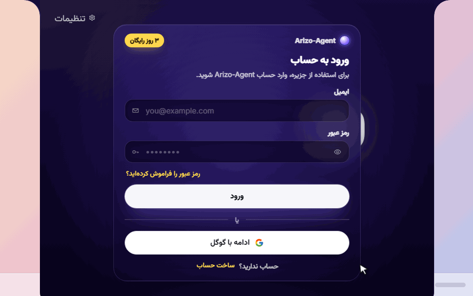

**حساب شما، همه‌جا** یک بار وارد شوید، در جزیره یا روی سایت: روزهای رایگان، بعد اشتراک.

</td>
</tr>
<tr>
<td width="50%" valign="top" dir="rtl">

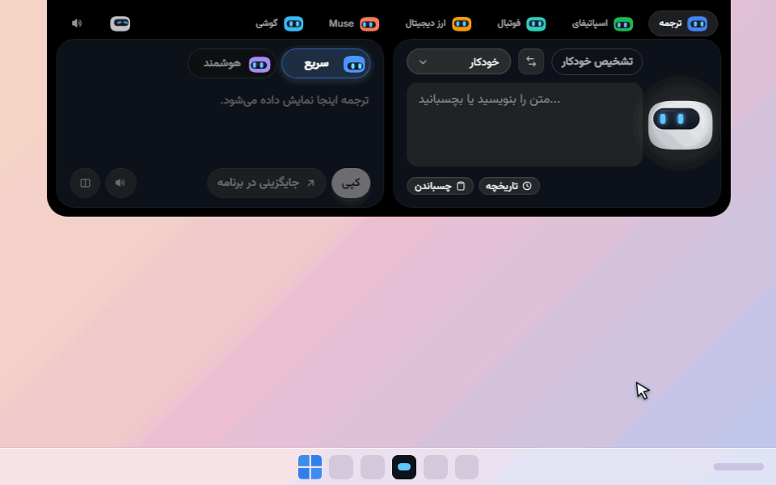

**ترجمه در هر جا** با `Alt+Shift+D` متن شما در همان برنامه به ترجمه‌اش تبدیل می‌شود.

</td>
<td width="50%" valign="top" dir="rtl">

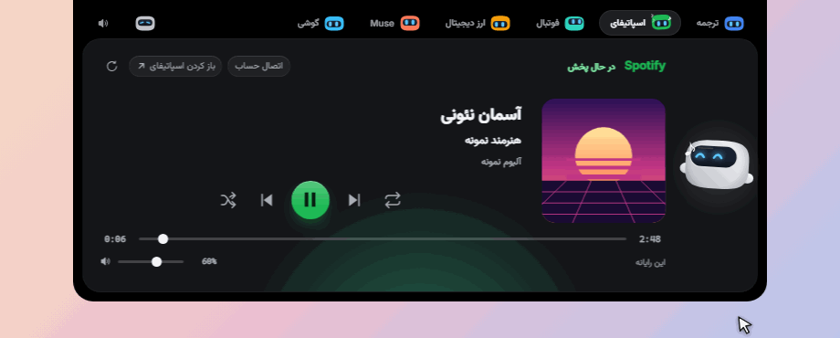

**موسیقی در جزیره** اسپاتیفای روی همین کامپیوتر یا حساب شما — و آری با آن می‌رقصد.

</td>
</tr>
<tr>
<td width="50%" valign="top" dir="rtl">

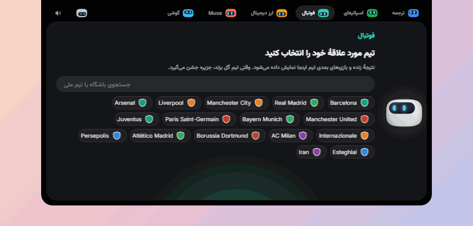

**فوتبال زنده** نتیجه، پیراهن تیم و یک جشن برای هر گل.

</td>
<td width="50%" valign="top" dir="rtl">

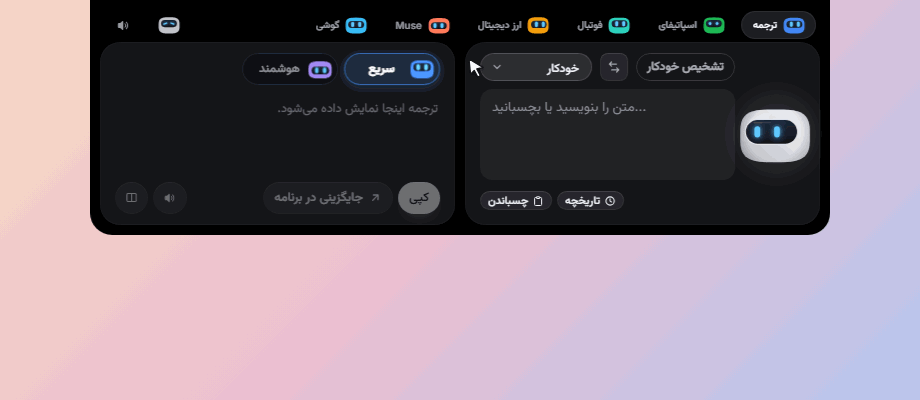

**کمد لباس آری** کلاه‌ها، فصل‌ها و هالووین — به سلیقه‌ی خودتان.

</td>
</tr>
<tr>
<td width="50%" valign="top" dir="rtl">

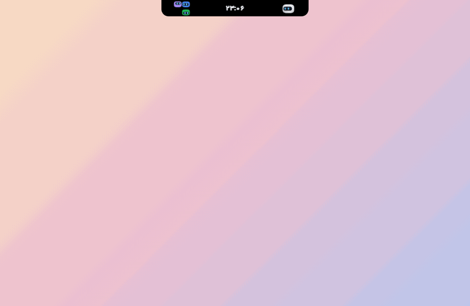

**ارز دیجیتال زنده** قیمت و نمودار شمعی صرافی شما، همیشه در دسترس.

</td>
<td width="50%" valign="top" dir="rtl">

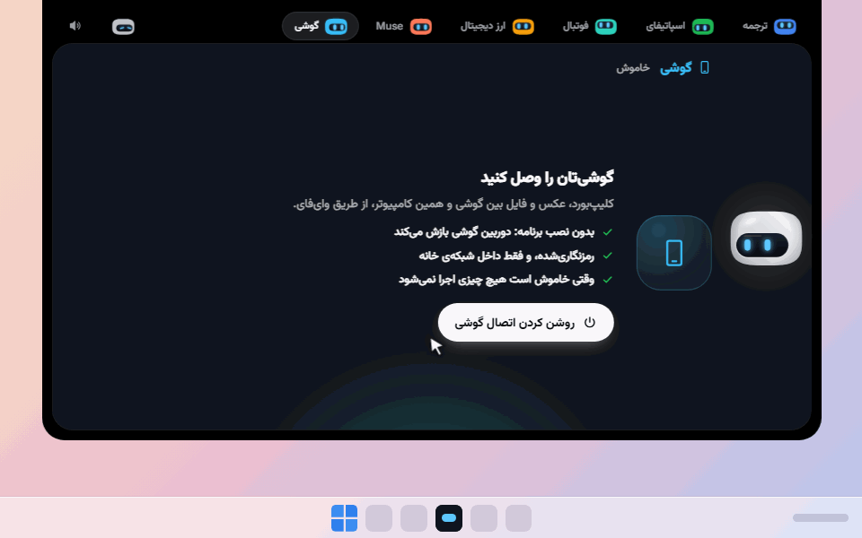

**پل** فایل و متن با گوشی، در خانه یا از هر جا از راه رله‌ی خودتان.

</td>
</tr>
</table>

🪟 ویندوز ۱۰ و ۱۱ &nbsp;·&nbsp; 🌐 فارسی و English &nbsp;·&nbsp; 🔒 بدون تلمتری — کلیدهای شما روی کامپیوتر خودتان می‌ماند &nbsp;·&nbsp; 🛰️ رله‌ی خودتان، رمزشده از دو سر

<a href="https://arizoteam.ir"></a>

دانلود، معرفی کامل قابلیت‌ها و اخبار در **[arizoteam.ir](https://arizoteam.ir)**.

<a href="https://arizoteam.ir"></a>

© ۲۰۲۶ ArizoTeam. همه‌ی حقوق محفوظ است. آریزو ایجنت نرم‌افزاری اختصاصی است؛ [LICENSE](LICENSE) را ببینید.

