<div align="center">


<br>

[](https://github.com/ArizoOwner/Arizo_Agent/releases)


[](https://github.com/ArizoOwner/Arizo_Agent/stargazers)

**🌐 Language:** English • [فارسی](README.fa.md)

**A Dynamic Island for your Windows desktop. It translates anything, plays your music, follows your football team, watches your crypto prices — and a little mascot named Ari keeps you company.**

[⬇️ Download](https://github.com/ArizoOwner/Arizo_Agent/releases) • [Features](#everything-in-one-look) • [Translate](#translate-anywhere) • [Spotify](#spotify-in-the-island) • [Football](#live-football) • [Crypto](#live-crypto) • [Wardrobe](#aris-wardrobe) • [Make it yours](#make-it-yours) • [Shortcuts](#keyboard-shortcuts) • [Install](#get-started) • [Privacy](#private-by-design) • [Build](#for-developers)


</div>

## Everything in one look

<div align="center">


</div>

Arizo-Agent lives at the top centre of your screen in a frameless, always-on-top **island** that is exactly as tall as its content — so the empty part never blocks a click on the app underneath. It never steals focus from what you're doing. `Ctrl+M` folds it into a capsule, and `Alt+D` opens it from anywhere.

Meet **Ari**: a soft little squircle with two dark eyes that breathes, blinks, follows your cursor from anywhere on the screen, thinks while a translation is on its way, dances when music plays, and celebrates when your team scores.

<br>


## Translate anywhere

<div align="center">

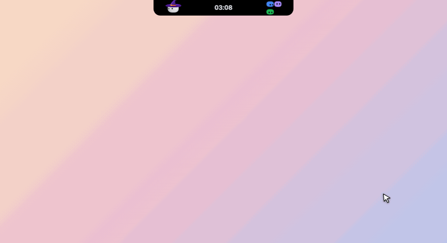

</div>

- ⚡ **Translate in place — `Alt+Shift+D`.** Type in Telegram, Discord, Word, Notepad, a web form or an IDE, press the shortcut, and your text is replaced by its translation in the field it was written in. Nothing selected? The whole field is used. No window opens.
- 🎯 **Quick-translate bubble.** Select text anywhere by dragging: a small button appears next to the cursor. Click it to translate, then copy, listen, or replace the selection. Plain clicks, double clicks, the desktop and the taskbar never trigger it, and your clipboard isn't touched until you click.
- 🧠 **Smart language handling.** Auto direction (your first language → your second, anything else → your first; swap with `Ctrl+S`), Persian-aware detection even for sentences full of English technical words, and an idiom polish that swaps literal renderings for the natural equivalent (« سنگ تمام گذاشت » → *spared no effort*, *piece of cake* → « مثل آب خوردن »).
- 🔁 **Never empty-handed.** If the Smart engine fails (no key, no network, quota) the translation is made with Fast, and you're told why.
- 🗣️ **Speech for every language** — including Persian, which Windows has no voice for.
- 📋 **Bilingual copy, PDF line-break cleaner, searchable history.** Copy source + translation together, undo the broken lines of a pasted PDF, and open **History** from inside Translate to star, search and re-translate what you did before.


## Two engines

| Engine | What it is | Best for |
| :--- | :--- | :--- |
| **⚡ Fast** | Google Translate's free endpoint, MyMemory as a second chance. No key, no limit, long text chunked automatically. | Everyday reading and chat |
| **✦ Smart** | A language model: tone control (formal, casual, technical, literary), idiom breakdown, alternative wordings, streamed as it is written. | Slang, idioms, code, formal mail |

**Smart providers:** OpenRouter, Google Gemini, DeepSeek, Groq, OpenAI, and local models (Ollama, LM Studio) that need no key — or any OpenAI-compatible endpoint. Switch engines with `Ctrl+Tab`.


## Spotify in the island

<div align="center">

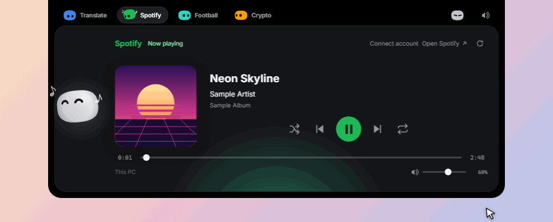

</div>

Two ways to listen — and you can use both.

- 🖥️ **On this PC, with no setup.** The island reads the Spotify desktop app through the Windows media controls and shows the cover, title, artist and timeline, with play/pause, previous/next, seek, shuffle, repeat and Spotify's own volume.
- ☁️ **With your account.** Connect once (OAuth with PKCE — you paste the Client ID of a free developer app you create and approve access in the browser; there is no client secret) to follow and control playback on your phone or any other device too. Account controls need Spotify Premium; a free account can watch. If both are playing, the account wins unless only this PC is.
- 💃 **Ari dances to the beat** (112 BPM) with little ♪ notes floating beside — white on the dark island, black on the light one.


## Live football

<div align="center">

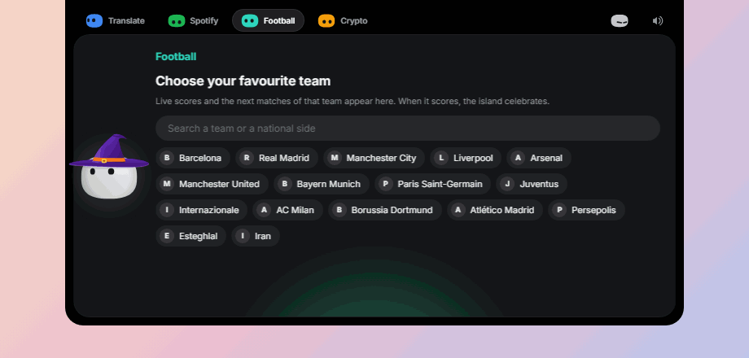

</div>

Pick a club or national side once, and the island shows its **live score**, the **next matches** (in their own framed card) and the **recent results**, read online — no account, no key. Kick-off dates and times follow your language: **Solar Hijri (شمسی)** in Persian, **Gregorian** in English, with Persian digits.

The score is read **every 3 seconds** while your team plays, and **every moment of the match gets its own show**: the island grows into a stage that fits it, Ari reacts, and a matching sound plays. Several events at once play in turn; bigger ones interrupt smaller ones. It works from the compact capsule and even from the fully hidden island.

<div align="center">


</div>

| Moment | The island | Ari | Sound |
| :--- | :--- | :--- | :--- |
| ⚽ Your goal | Grows to a full stage, goal rain, scorer and score | Jumps for joy, stars and hearts | Crowd cheer |
| 😬 Goal against | Blue drops, the scorer and score | Tired eyes, sweat | A groan |
| 🟨 Yellow card (yours or theirs) | Falling yellow cards | Surprised, or a wink | Card |
| 🟥 Red card / opponent sent off | Red cards, a red glow | Droops, or cheers when it is theirs | Card |
| 🏁 Kick-off, second half | Falling balls | Happy | Whistle |
| ⏸️ Half-time | A calm teal stage | A wink | Whistle |
| 🏆 Full time | Win: confetti. Draw: calm. Loss: drops | Cheers, shrugs or droops | Cheer, whistle or groan |

### 👕 Ari in your team's kit

In the Football section Ari wears the **real shirt of your favourite team**: Barcelona's blue and garnet stripes, Real Madrid's white with black trim, Juventus, PSG, Milan, Esteghlal… (any other team takes its own colour). The shirt is drawn in 3D with his head — when he looks down or turns, the collar, stripes, badge and number follow, and his eyes never sink into it. A switch in Settings turns it off, and everywhere else he keeps his usual outfit.

<div align="center">


</div>


## Live crypto

<div align="center">

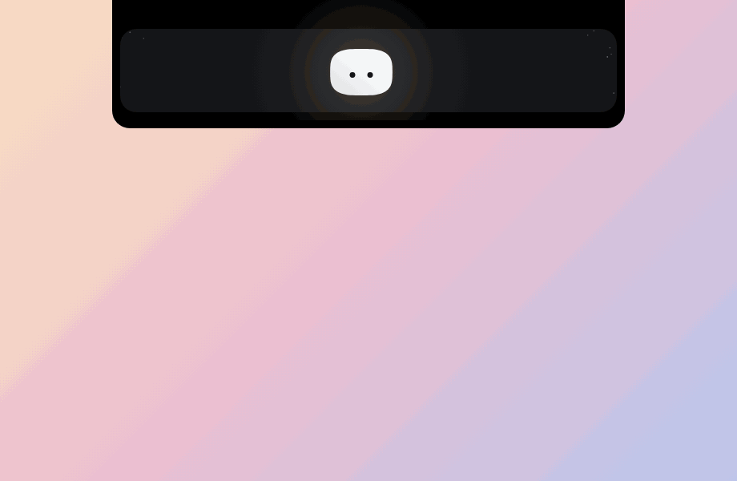

</div>

**Added in 3.3.** Connect **your own exchange account** once and the island shows the **live price** of any coin, a **candlestick chart** and your **favourite coins** — read straight from the exchange, with no middleman and no invented numbers. Nothing is shown until the exchange has accepted your key.

<div align="center">


</div>

- 🏦 **Your exchange, your key.** Pick **Nobitex**, **Binance** or **Toobit** and paste a **read-only** API key. The app only reads: it never trades, withdraws or places an order.
- 📈 **Candles, from one minute to one day.** A candlestick (or line) chart with volume, a hover crosshair and the open, high, low and close of each candle — plus the 24-hour high, low and volume. Choose the **timeframe from a dropdown**: 1m, 5m, 15m, 1h, 4h or 1d.
- 🪙 **The coin list comes from the exchange.** Every coin the exchange lists, with its price and change, is searchable in the dropdown, and the **coin icons are loaded online** (with a drawn fallback if one is missing).
- ⭐ **Favourites and a default coin.** Star the coins you follow (up to 40); they sit in a bar under the picker for one-click switching. Mark one as the **default**: it is the first coin the island shows every time it starts.
- 💵 **Toman as `T`, dollars as `$`.** On Nobitex the price toggles between Toman — written `4,795,000,000 T` on one line, with the chart axis in millions — and USDT. **Tether** is in the list too.
- 🌓 **Made to match.** Light and dark themes, and the Persian interface lays everything out right-to-left with firm digits in Vazirmatn.
- 🔋 **Quiet when you don't look.** Prices are read **only while the Crypto section is on screen** (every 5 s on Nobitex, 3 s on Toobit, 2 s on Binance), then the app goes back to sleep.

<div align="center">


</div>

| Exchange | Your key | Prices in |
| :--- | :--- | :--- |
| **Nobitex** | Public key + private key (*Account → API services*, read access). Every request is signed with Ed25519; the private key is shown only once, when you create it | Toman and USDT |
| **Binance** | API key + secret (read-only), signed with HMAC-SHA256 | USDT |
| **Toobit** | API key + secret (read-only), signed with HMAC-SHA256 | USDT |

On Nobitex, Tether trades only against the Toman, so it shows its Toman price (Nobitex publishes no candles for it, so only the live price and the 24-hour figures appear). Keys can be changed or removed any time with **Change API**, and the whole section can be switched off in **Settings**.


## Ari's wardrobe

<div align="center">

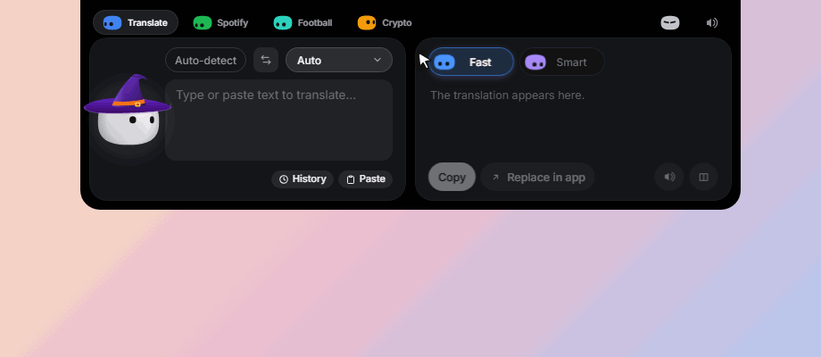

</div>

Hats and accessories — witch hat, party hat, crown, sunglasses, bunny ears… — and the **seasons dress him on their own**. Open the wardrobe from **Settings**, or right-click Ari.


## Make it yours

<div align="center">

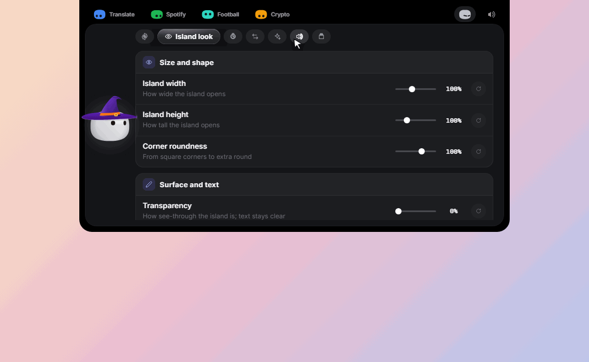

</div>

**New in 3.4.** Settings → **Island look** is where the island becomes yours. Every slider shows its change on the real island while you drag, saves when you let go, and has its own **back to default** button (plus one for all of them).

- 📐 **Size and shape.** Width 80–130 %, height 90–130 %, corners from square to extra round (0–150 %).
- 🫧 **See-through.** Make the island and its cards transparent up to 70 % — the text stays fully clear.
- 🔠 **Any text size.** From 80 % to 140 %: the buttons, cards and rows wrap or share the room instead of leaving the island, overlapping or being cut — in every view, in English and in Persian.
- 🪂 **Floating.** Hang the island 4–60 px below the top edge instead of touching it.

<div align="center">


</div>

- 💊 **The folded island is yours too.** The capsule has its own **width** (60–160 %), **height** (90–180 %) and **zoom** (70–180 %): Ari, the clock and the mini Aris grow and shrink together and always keep their places. A small drawing above the sliders shows what you are making, because the capsule itself is out of sight while Settings is open.

<div align="center">

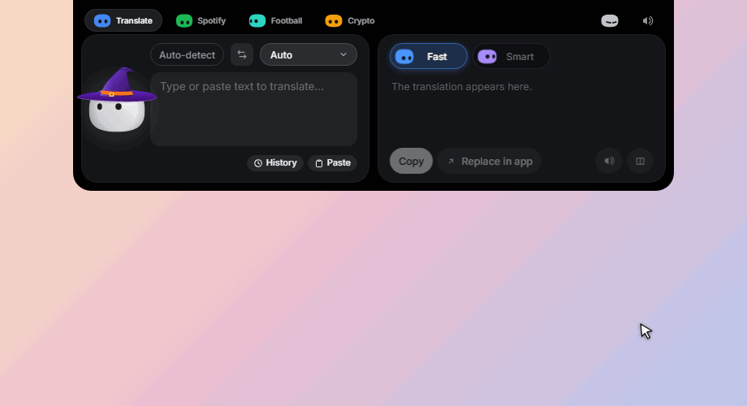

</div>

- 🧲 **Drag the tabs.** Pick up Translate, Spotify, Football or Crypto in the header and drop it where you want it: the others slide aside, and the order is remembered (mirrored in Persian).

## Made to feel good

<div align="center">

| | |
| :---: | :---: |
| 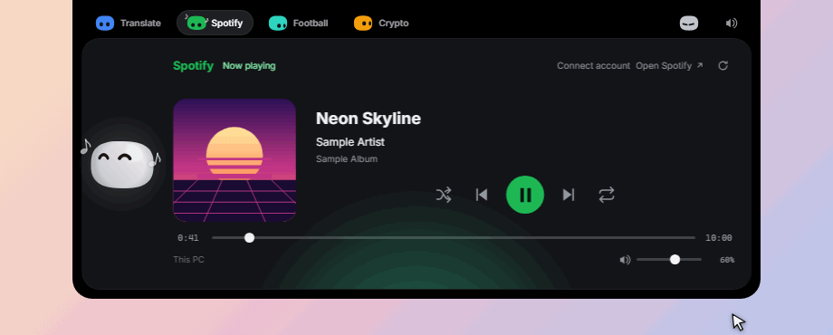<br>**Island, capsule, hidden** — `Ctrl+M` | 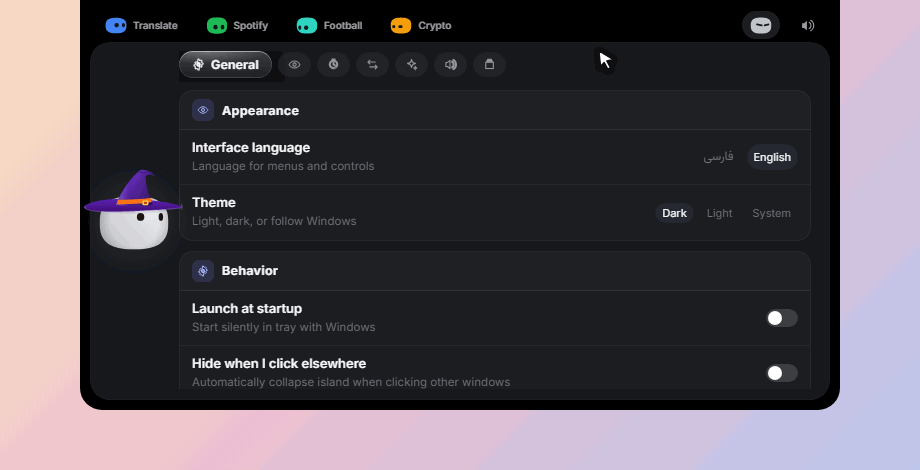<br>**Settings** — `Ctrl+,` |
| 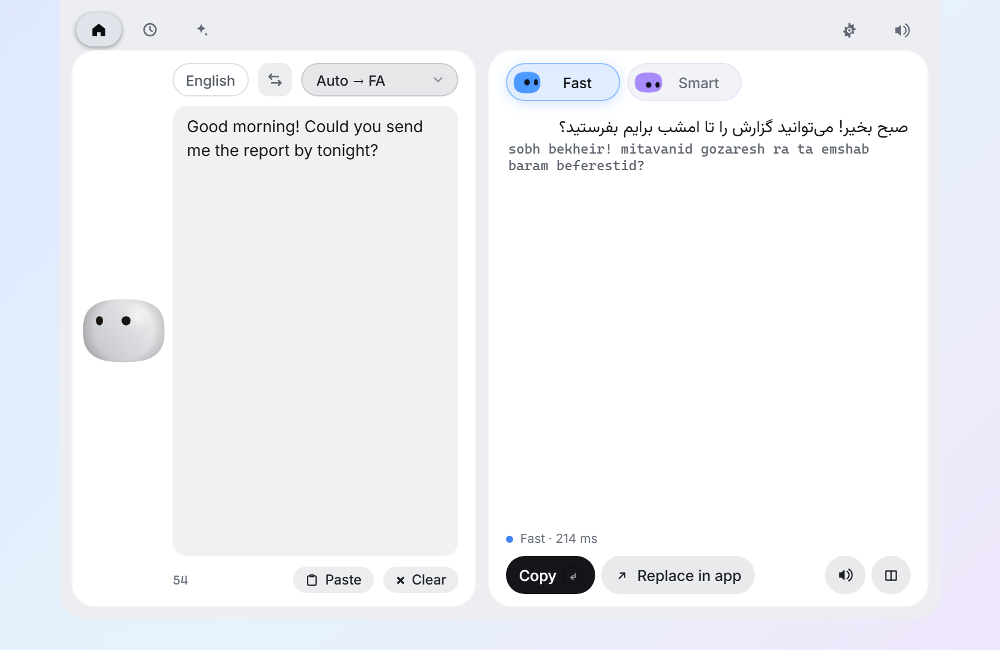<br>**Dark, light, or follow Windows** | 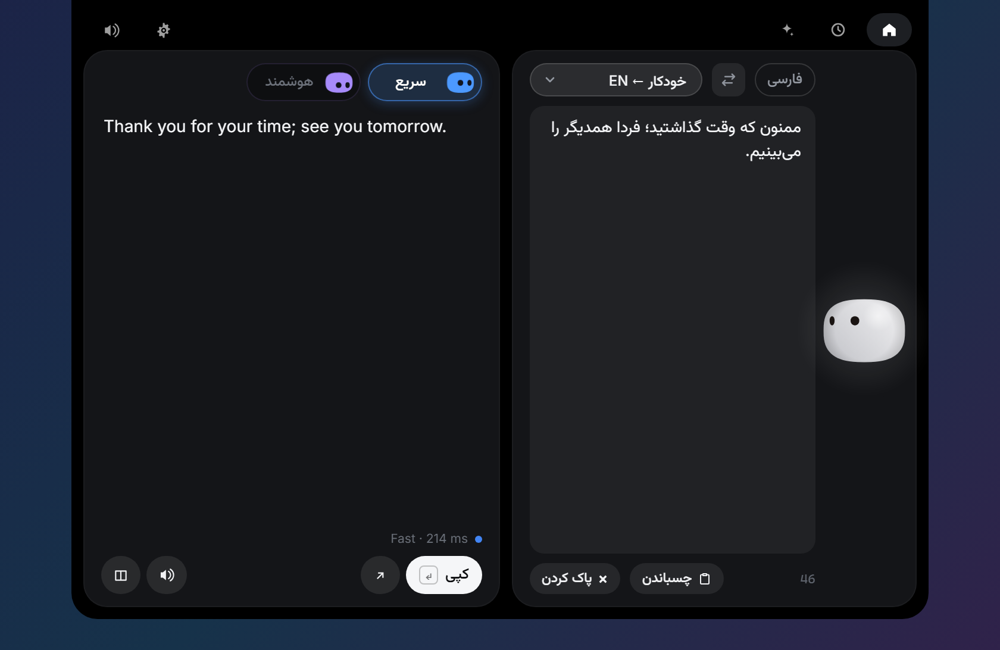<br>**Persian (RTL) or English interface** |

</div>

- ✨ **A mini companion for every feature.** Translate, Spotify, Football, Crypto and Settings each have their own animated, colour-coded miniature in the header. The green one dances with the music.
- 🔊 **33 original sounds** — a soft, synthesized sound for every gesture, all generated from code (`npm run sounds`). Mute or set the volume in Settings.
- 🌓 **Looks the part** — dark, light, or follow Windows. Persian (right-to-left, Vazirmatn) or English interface, switched live.
- 🪶 **Lightweight** — Rust and the system WebView2 instead of a bundled Chromium.

## Keyboard shortcuts

| Shortcut | Action |
| :--- | :--- |
| `Alt+D` | Open the island (on the selected text, if any) |
| `Alt+Shift+D` | Translate in place, in any app |
| `Alt+Shift+H` | Hide or show the island completely |
| `Ctrl+Tab` | Switch engine |
| `Ctrl+S` | Swap languages |
| `Ctrl+M` | Capsule mode |
| `Ctrl+,` | Settings |
| `Enter` | Copy and close |
| `Ctrl+Enter` | Replace the text in the app you came from |
| `Esc` | Close |

The three global shortcuts can be changed in **Settings**: click the field and press the new keys. If another app holds a combination, the previous one is kept.


## Get started

<div align="center">


</div>

Download from the [Releases](https://github.com/ArizoOwner/Arizo_Agent/releases) page:

| File | What it is |
| :--- | :--- |
| `Arizo-Agent-Setup-3.4.0.exe` | Installer for the current user — no administrator rights |
| `Arizo-Agent-3.4.0-Portable.exe` | One executable, runs without installing |
| `SHA256SUMS.txt` | Checksums of both |

The installer is **not code-signed**, so Windows SmartScreen shows a warning the first time: click **More info → Run anyway**. The app is open source — read it, or build it yourself.

The app lives in the notification area. Closing the island only hides it; quit from the tray menu.

**Upgrading from 2.x?** The first launch imports the settings and history of the Electron version (`%USERPROFILE%\.aphra-translate`). Its API key was encrypted for that app and cannot be read by this one: enter it once in **Settings**.


## Private by design

- **No telemetry.** Nothing is sent anywhere you didn't ask for.
- The text you translate goes to the engine you chose: Google (and MyMemory as its fallback) for Fast, your provider for Smart. Speech goes to Google's text-to-speech.
- **Your API key** is kept in the Windows Credential Manager. It is never written to a file and never handed to the page — the interface can only ask whether one exists.
- Settings and history stay on your PC, in `%APPDATA%\Arizo Translate`. This legacy folder, the credential service and the bundle identifier are intentionally preserved, so upgrades keep your data and API key.
- Spotify: on this PC the island only reads the media session Windows already shows for the Spotify app and sends it the usual play/pause/skip requests; nothing leaves your computer. The account is optional and used only after you connect it. Its access covers your playback state, playback control and your plan (Premium or free) — nothing else. The token is kept in the Windows Credential Manager, never in a file and never in the page, and **Disconnect** deletes it.
- Football: the island asks ESPN's public football data for your team's id (and, for a live game, its league and day) — nothing about you is sent, no account or key is involved, and the team you chose is only stored in your settings file. Turn it off in Settings and nothing is requested.
- Crypto: you bring your own exchange key. It is kept in the Windows Credential Manager (one entry per exchange), never in a file and never in the page, and **Change API** deletes it. The app only sends read requests — prices, candles and a check that the key works — straight to the exchange you chose (Nobitex, Binance or Toobit); there is no server of ours in between, and prices are only requested while the Crypto section is on screen. Turn the section off in Settings and nothing is requested. The one exception is the coin icons, which load from public image servers (cdn.nobitex.ir, with assets.coincap.io as a fallback): those servers see which coins are drawn and your IP address.
- Your clipboard is borrowed for a moment to read a selection or paste a translation, and given back (text and images).


## For developers

You need [Rust](https://rustup.rs), [Node.js 20+](https://nodejs.org) (22.18+ to run the tests) and the **MSVC build tools** (Visual Studio Build Tools with "Desktop development with C++"). WebView2 ships with Windows 10/11.

```powershell
git clone https://github.com/ArizoOwner/Arizo_Agent.git
cd Arizo_Agent
npm install
npm install --prefix web
npm run dev            # live-reloading development build
npm test               # Rust + front-end test suites
npm run pack           # installer + portable exe + checksums in release/
npm run readme-gifs -- translate both   # record a README animation from the running app (npm run web first)
```

```
web/                      the island, the bubble and the settings window
  src/ari/                Ari: the engine, the wardrobe, the outfits
  src/views/              translate, history, settings, crypto, the themed dropdown
  src/core/               state, bridge, theme, sound, layout…
src-tauri/src/            Rust backend
  lib.rs                  windows, tray, shortcuts, the commands the page calls
  input.rs                Win32: copy, paste, focus, the selection watcher
  google.rs  aphra.rs     the two engines        translator.rs  cache, fallback, history
  langs.rs  idioms.rs     detection and polish   store.rs       settings, history, API key
  textutil.rs  tts.rs     chunking and speech
  crypto.rs               the exchanges: signed requests, prices, candles, the poller
scripts/                  icon + sound generators, packaging, README art and the animation recorder (readme-gifs/)
```

The icon is drawn in code (`npm run icons`) and so are the sounds (`npm run sounds`) and the animated art of this page (`npm run readme-art`). The animations of the features are not drawn: `npm run readme-gifs` drives the real interface in a headless browser with real mouse and keyboard events and records what it paints, so they always show the version that is in the repository.

**Contributing.** Issues and pull requests are welcome. Run `npm test` before you open one. Translations of the interface live in `web/src/i18n/`. See the [changelog](CHANGELOG.md) for what's new.

## Credits

Ari's island and engine are ported from [Coucou](https://github.com/Louis-CFM/coucou) by Louis Raillé (MIT) — see [NOTICE.md](NOTICE.md). Fonts: [Vazirmatn](https://github.com/rastikerdar/vazirmatn) and [Inter](https://rsms.me/inter/) (SIL OFL). Built with [Tauri](https://tauri.app/).

## License

- **Code:** [MIT](LICENSE) — use it, fork it, learn from it, just keep the copyright notices.
- **Name, icon, sounds and media:** © ArizoOwner, all rights reserved — see [LICENSE-ASSETS.md](LICENSE-ASSETS.md). Shipping your own fork? Give it your own name and icon.

<div align="center">


</div>
