

<a href="https://arizoteam.ir"></a>

**English** · [فارسی](README.fa.md)

**A Dynamic Island for your Windows desktop.** It translates anything, plays your music, follows your football team, watches your crypto prices, shows your game's FPS and links your phone — while a little robot named **Ari** keeps you company.

<a href="https://github.com/ArizoOwner/Arizo_Agent/releases/latest"></a>

### What's new in 2.2

- **Game Mode:** when a game fills the screen, Ari powers up and the island shows FPS, CPU, GPU and temperature beside him; a hotkey opens a tool overlay, and nothing pops up while you play
- **A real FPS counter,** read the way Xbox Game Bar reads it, and CPU and GPU numbers that match Task Manager
- **A calm new entrance** with its own soundtrack, and numbers in the size and colour you pick
- **Your account, everywhere:** e-mail or Google, free days, then a plan paid in TON

[**Download 2.2.2 →**](https://github.com/ArizoOwner/Arizo_Agent/releases/latest)

<table>
<tr>
<td colspan="2" valign="top">

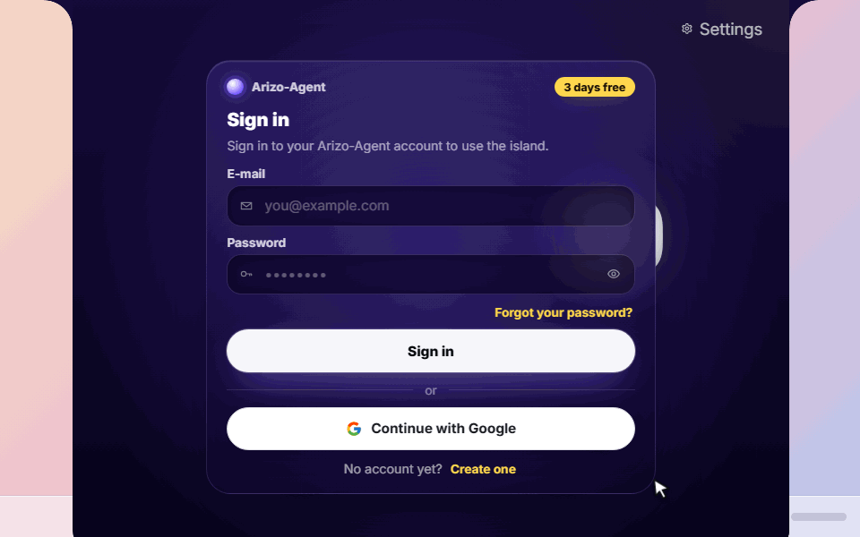

**Your account, everywhere** Sign in once, in the island or on the site: free days, then a plan.

</td>
</tr>
<tr>
<td width="50%" valign="top">

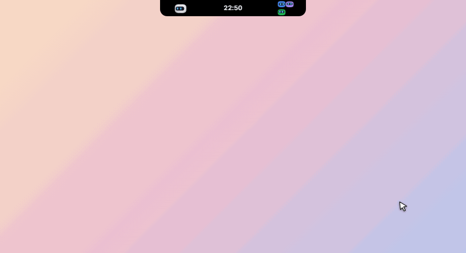

**Translate anywhere** `Alt+Shift+D` swaps your text for its translation, in any app.

</td>
<td width="50%" valign="top">

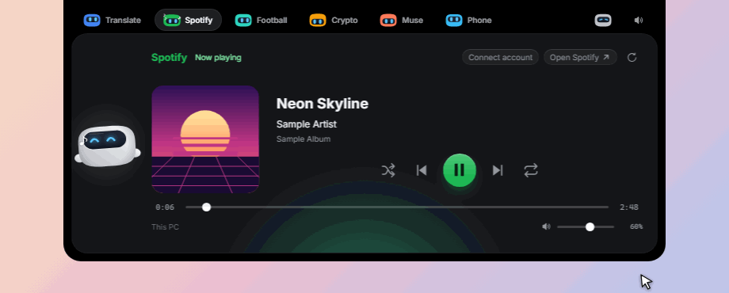

**Music in the island** Spotify on this PC or your account — and Ari dances to it.

</td>
</tr>
<tr>
<td width="50%" valign="top">

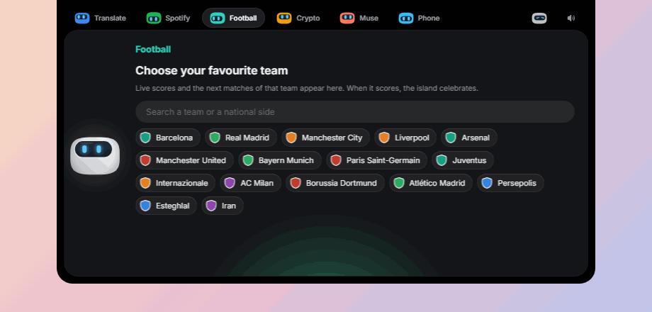

**Live football** Your team's score, kit and a show for every goal.

</td>
<td width="50%" valign="top">

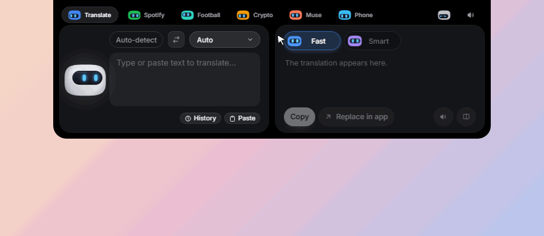

**Ari's wardrobe** Hats, seasons and Halloween — dress him your way.

</td>
</tr>
<tr>
<td width="50%" valign="top">

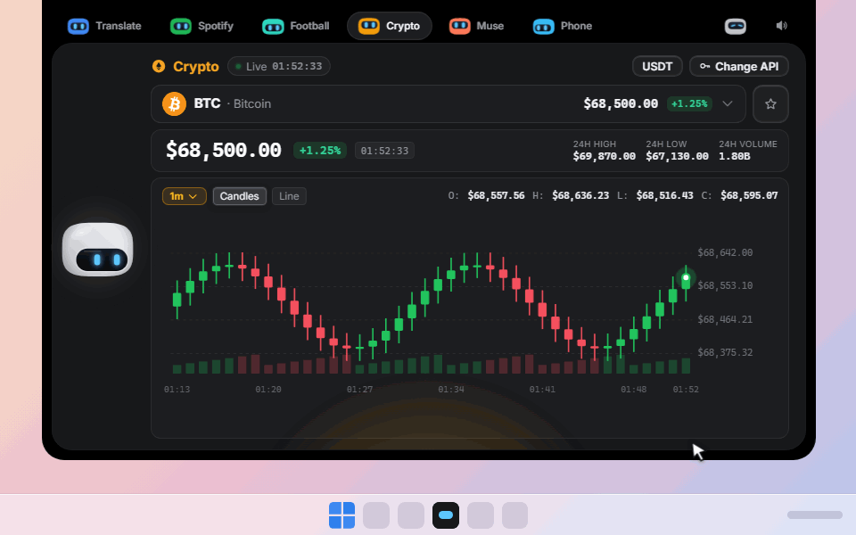

**Live crypto** Prices and candles from your exchange, right on top.

</td>
<td width="50%" valign="top">

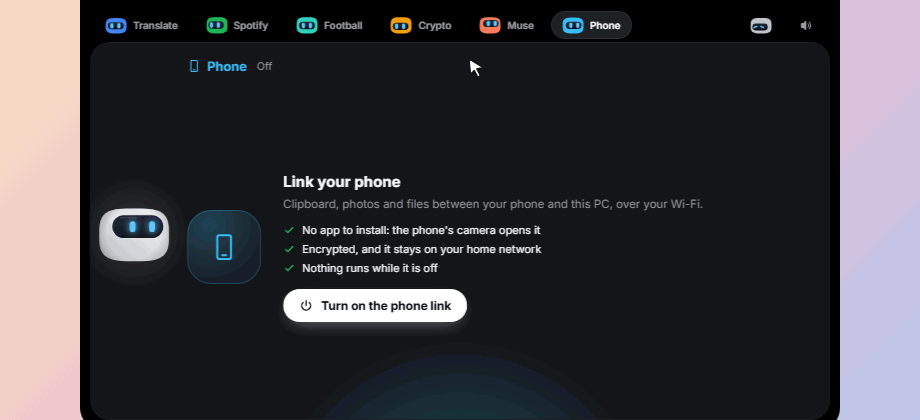

**The Bridge** Files and text with your phone, from home or from anywhere through your own relay.

</td>
</tr>
</table>

🪟 Windows 10 & 11 &nbsp;·&nbsp; 🌐 English & فارسی &nbsp;·&nbsp; 🔒 No telemetry — your keys stay on your PC &nbsp;·&nbsp; 🛰️ Your own relay, sealed end to end

<a href="https://arizoteam.ir"></a>

Downloads, the full feature tour and news live on **[arizoteam.ir](https://arizoteam.ir)**.

<a href="https://arizoteam.ir"></a>

© 2026 ArizoTeam. All rights reserved. Arizo-Agent is proprietary software; see [LICENSE](LICENSE).

